# Hierarchical OD Pricing and Private-Utility Repositioning for NYC Ride-Hailing

## A. Research abstract and current status

This repository studies destination-based dispatch pricing coupled to private driver repositioning, EV charging, demand forecasting and federated routing-response estimation. A top-level deep Q-network prices supported origin–destination (OD) pairs; passengers accept or reject prices under a population sensitivity model, while drivers retain private utility-based decisions. Locally learned routing responses are aggregated and enter subsequent pricing states. The research objective is discounted revenue from successful assignments, not revenue from merely accepted requests.

**Review snapshot: 20 November 2026.** The latest verified master-alignment milestone is **two chronological eight-hour episodes (32 slots), 256 pricing updates and 32 NONPRIVATE FedAvg rounds**. Episodes 3–35 have not run. This is an engineering and bounded-learning result, not a converged policy, operational deployment, private-learning guarantee or publication-ready effectiveness claim. All training and implementation development are paused for this review.

The [readable master specification extract](results_v2/publication/master_specification_excerpt.md) reproduces the normative source at `notebooks/plan/masterdocument/MASTER DOCUMENT1.docx`; the original DOCX remains unchanged. This README is the current review entry point; historical reports describe their own dated contracts and may contain superseded readiness statements. The [prior root text](results_v2/publication/root_readme_before_review.md) is retained verbatim as an archival snapshot, not a competing current guide. Existing source changes and historical evidence have not been reverted.

**Critical qualifications:** the trained CNN underperforms a historical-average benchmark; current hierarchical training uses that benchmark rather than CNN output. Weather availability is assumption-based. Common sensitivity references and continuous-weather alignment remain provisional. Active federation is nonprivate. Final policy benchmarks, EV-penetration comparisons and protected-period evaluation remain outstanding.

## Current Research Status and Next Steps

Latest verified experiment evidence: **20 November 2026**, from the [two-episode validation](results_v2/pricing_dqn/2026-11-20_multi_episode_orchestration/validation.json). Status below describes bounded engineering evidence, not scientific superiority or complete master compliance.

| Component | Status | Verified scope or remaining limitation |
|---|---|---|
| NYC data and spatial mapping | VALIDATED | Versioned 142-cell true-3-km geometry and bounded replay reconciliation |
| CNN prediction | PARTIALLY_VALIDATED | Causal Softplus trained; worse than historical mean; assumed weather timing |
| Passenger sensitivity | PARTIALLY_VALIDATED | Count-weighted binned sampler tested; references/weather/tails remain qualified |
| OD pricing DQN | PARTIALLY_VALIDATED | Learning demonstrated; no final policy effectiveness evaluation |
| Dispatch and reward | VALIDATED | Successful assignments reconcile to reward and separate fallback revenue |
| Driver repositioning | VALIDATED | Private utility and bounded learned-response feedback tested |
| EV charging | PARTIALLY_VALIDATED | Seven event records in latest pilot; completed-cycle/long-run coverage not established |
| Federated learning | PARTIALLY_VALIDATED | 32 equal-client rounds; active mode NONPRIVATE |
| Differential privacy | PENDING | Active hierarchical mechanism and accounting not validated |
| Gymnasium environment | IMPLEMENTED | Adapter fixtures; full training campaign uses direct runtime |
| Checkpoint and reproducibility | VALIDATED | Exact bounded cross-episode recovery |
| Multi-episode training | PARTIALLY_VALIDATED | Two 16-slot episodes complete; remaining33 not executed |
| EV penetration comparisons | NOT_EVALUATED | 10/20/30% initialization exists; performance comparison pending |
| Publication evaluation | NOT_EVALUATED | Frozen-policy benchmarks and protected evaluation pending |

Current pricing training uses **historical-average forecasts**, not the trained CNN. Earlier short runs had zero charging events; the latest pilot records3+4 events. Event records must not be represented as completed charging sessions. March17–31 remains protected in the current research protocol; older historical reports have different evaluation scopes.

### Next steps

1. Complete academic methodology review.
2. Review the complete passenger acceptance and pricing evidence.
3. Approve pending research decisions.
4. With explicit authorization, continue training from authoritative Episode 2; episodes 3–7 are not evidenced as complete.
5. Perform frozen-policy development evaluation.
6. Complete approved privacy and 10/20/30% EV studies, including charging-cycle validation.
7. Conduct protected evaluation after freezing selection, then finalize the publication package.

Training remains paused; this evidence-extraction task launches no training. Update this table only from new validated evidence.

**Navigation:** [Architecture](#c-end-to-end-architecture) · [CNN](#f-cnn-forecasting-implemented-not-the-active-hierarchical-input) · [Sensitivity](#g-passenger-elasticity-and-acceptance) · [Mathematics](#n-training-mathematics-and-hyperparameters) · [Results](#q-verified-experiments-and-latest-milestone) · [Open decisions](#t-open-methodological-decisions-and-experimental-limitations) · [Reproduction](#u-reproducibility-and-execution-reference)

## B. Objectives and contributions under investigation

The intended contributions are an OD-specific pricing controller, empirically conditioned passenger response, local utility-preserving driver decisions, federated routing feedback and reproducible temporal simulation. Implemented contributions include versioned mathematical/information contracts, explicit historical-request replay, masked spatial responses, mixed-fleet safety and full-state checkpoint restoration. Their implementation is distinguishable from evidence of policy benefit. The present experiments establish bounded numerical and integration correctness; they do not identify causal willingness-to-pay, demonstrate privacy, or establish optimal pricing.

## C. End-to-end architecture

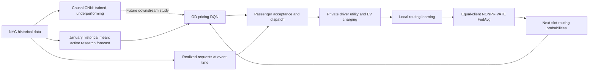

The global routing network estimates aggregate responses; it does **not** replace private utility maximization. Therefore routing probabilities can change without changing physical driver actions in a fully exploratory/no-pricing-update control. The [coupling validation](results_v2/federated_learning/2026-11-18_hierarchical_coupling_validation/README.md) demonstrates that all nine routing dimensions reach the pricing network and affect its forward computation. It does not require an untrained network to select a different greedy action.

## D. Dataset, spatial grid and time

The primary population is NYC Yellow Taxi historical trips in January–March 2026, using recorded pickup/drop-off, zone IDs, fare and distance. Trips proxy realized passenger requests; missing rejected/unserved demand is not recovered. Calendar coverage of a source file does not authorize reading its protected evaluation rows.

The active geometry is **142 valid true 3-km cells on a 16×16 raster**, with explicit validity and neighbour masks. Cardinal movement is 3 km; diagonal movement is $3\sqrt{2}$ km; STAY is zero. Zone/grid membership uses polygon-intersection inclusion, with no centroid/majority substitution in the mapping metadata. Taxi-zone assignment is an approximation to unavailable individual GPS positions, not exact passenger localization. [Grid metadata](data/processed/spatial_3km_jan_mar_2026/grid_metadata.json), [zone mapping metadata](data/processed/spatial_3km_jan_mar_2026/zone_grid_mapping.metadata.json) and [raster mapping](data/processed/spatial_3km_jan_mar_2026/grid_raster_mapping.metadata.json) identify the saved geometry. Legacy grid versions are not interchangeable. Code action order is STAY,N,NE,E,SE,S,SW,W,NW (zero-based); the master describes clockwise order starting from the left. This indexing deviation is explicit; saved masks/labels must never be reinterpreted without their action contract.

Internal events use UTC elapsed time; America/New_York supplies calendar features. Slots are 30 elapsed minutes and mini-slots 120 seconds. March 8 has 46 local half-hours: 01:30 EST advances to 03:00 EDT, without fabricated 02:00/02:30 intervals. Arrival, repositioning and charging durations remain elapsed durations. See [UTC runtime validation](results_v2/simulation/2026-11-17_utc_od_runtime/README.md) and [temporal implementation](src/simulation/utc_od_state.py).

## E. Cleaning, preprocessing and population accounting

Population definitions are versioned rather than silently combined. Historical Record-029 used its own cleaned population and signed estimator; it is not the current binned calibration. The binned Jan1–Mar15 analysis uses 6,967,155 eligible fare/distance records with $1.5\leq L<75$ km. Prospective sampling refits positive binned values using **5,457,435 Jan–Feb records**. These counts are not the full demand or runtime request populations.

[Historical request replay](results_v2/simulation/2026-11-17_historical_request_replay/README.md) validates observed origin/destination, timestamps, finite positive trip distance and fare, and positive elapsed duration through the existing eligibility path. Source identities order ties deterministically; predictions never generate request counts. Invalid spatial mappings and unchanged eligibility exclusions are reconciled separately. Unsupported but valid unseen ODs use an explicit reference-price fallback; they are not silently deleted or added to learned support. See [replay source](src/simulation/historical_request_replay.py) and [unseen-OD acceptance evidence](results_v2/simulation/2026-11-17_end_to_end_acceptance/README.md).

The newest pilot reconciles **70,106 source rows = 1,261 excluded rows + 68,845 eligible requests**, including 36 fallback requests. This verifies its selected windows, not a universal quarter-wide cleaning total or a raw-data deduplication audit. The complete per-episode records are linked in the evidence index. No raw preparation or cleaning was rerun for this review.

## F. CNN forecasting: implemented, not the active hierarchical input

Master §4 requires seven aligned planes, nonnegative expected counts and chronological forecasting. The implemented channel order is day of week, hour, half-hour period, weather code, temperature (°C), wind speed (km/h), and historical average demand. Tensor layout is $(N,7,16,16)$, with internal framework layout conversion and 142-cell loss/output masking. Calendar/code features use fixed scaling; weather uses prior moments; historical counts use causal training-history scale. Targets and reported errors remain original request counts. Held-out labels do not update historical means or scaling.

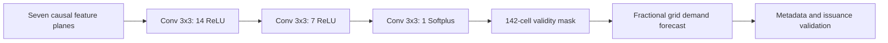

The 14→7→1 model differs from the larger illustrative §4 architecture, which is explicitly proposed rather than source-mandated. ReLU-output and output-only Softplus experiments are separately preserved. Adam learning rate 0.001, batch64, seed42, no shuffle, maximum100 epochs and validation patience10 are experiment settings. Softplus selected epoch42 and stopped52; ReLU selected50 and stopped60.

Training is Jan1–Feb28 (2,830 samples after two no-history exclusions), validation March1–15 (718), development March16 (48). March17–31 remains protected. Issuance is 30 elapsed minutes before target start; labels cover the following 30-minute interval. The master includes inconsistent illustrative issuance examples; the implemented convention is explicit and tested. The master’s proposed Jan1–Feb20/Feb21–28 split was not the executed split.

Weather uses the latest complete observation whose **assumed** availability, observation time +120 minutes, precedes issuance. This is not an archived operational forecast. The [persistence protocol](src/demand/persistence_weather.py) must wrap the causal-history builder; its oracle-weather path is not an operational forecast. [Forecast export](results_v2/cnn_demand/2026-11-18_softplus_causal_research_training/forecast_contract.json) binds channels, grid/mask, model and preprocessing hashes. A model selected on March1–15 cannot be backdated into the prospective March1/March12 experiment merely because its features are causal.

| Population | ReLU MAE / RMSE | Softplus MAE / RMSE | Historical-average MAE / RMSE |
|---|---:|---:|---:|
| March1–15 validation | 7.107571 / 26.145924 | 7.013677 / 26.027186 | 3.518426 / 18.226779 |
| March16 development | 9.167995 / 39.863315 | 8.956793 / 39.232116 | 5.085002 / 29.771590 |

Units: requests per valid grid per half-hour; 101,956 and 6,816 grid-time observations respectively. [Exact consolidated metrics](results_v2/publication/tables/cnn_metrics.csv) are regenerated from saved metrics and independently checked against saved Softplus predictions.

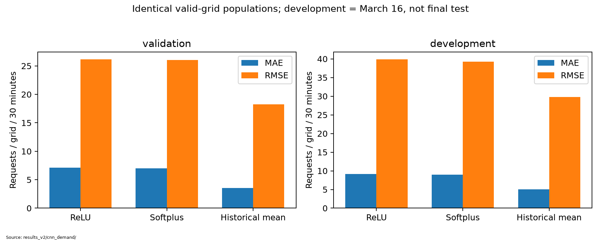

The [activation diagnosis](results_v2/cnn_demand/2026-11-18_cnn_activation_gradient_diagnosis/README.md) directly identified blocked final-ReLU gradients. Softplus removed that exact mechanism but retained severe near-zero predictions: 86.18% of positive validation cells below0.01 requests. The [final diagnosis](results_v2/cnn_demand/2026-11-18_softplus_final_diagnosis/README.md) found strongly negative pre-activations and small gradients, rather than a verified scaling/alignment defect or entirely dead hidden representation. High-demand cells dominate squared errors. CNN work is frozen; no superiority or additional justified retraining is claimed here.

Further figures: [loss curves](results_v2/publication/figures/cnn_training_loss.svg), [high/low grids](results_v2/publication/figures/cnn_high_low_grids.svg), [city counts](results_v2/publication/figures/cnn_city_development.svg), [spatial and signed errors](results_v2/publication/figures/cnn_spatial_error.svg). Positive signed error means underprediction. These are saved prediction summaries, not new inference.

## G. Passenger elasticity and acceptance

Master §3.1 defines a distance-over-price relative-change estimator. For bin $b$ with lower distance $l_b$ km, mean fare $\bar P_b$ USD and request count $n_b$:

**R1a.**

$$
\epsilon_b=\frac{(l_b-L_0)/L_0}{(\bar P_b-P_0)/P_0}
$$

**R1b.**

$$
P_0=22.354198442390455\ \mathrm{USD}
$$

**R1c.**

$$
L_0=4.616983790655043\ \mathrm{km}
$$

The 0.5-km bin estimator preserves undefined/nonpositive estimates diagnostically; positive finite values form sampling support. These common references remain **PROVISIONAL_ASSUMPTION**: inherited count-weighted fare mean/interpolated crossing provenance differs from the master’s selected observed fare/representative distance procedure. Historical Record-029 used the reverse signed ratio and its own references. Its results remain historical evidence, not interchangeable estimates of R1.

For supported weather/time pool $c$, request-count empirical resampling is

**R2a.**

$$
w_{b|c}=n_{b,c}/\sum_{k\in B_c^+}n_{k,c}
$$

**R2b.**

$$
\epsilon\sim\sum_{b\in B_c^+}w_{b|c}\delta_{\epsilon_{b,c}}
$$

$B_c^+$ is the set of positive finite bin estimates in pool $c$; $\delta_{\epsilon}$ denotes a point mass at that sensitivity value. This represents the observed historical distance mixture; it does not identify individual elasticity. Draws use replacement and controlled RNG, independent of the requesting passenger’s own distance bin. Bounds are the positive empirical support, without fabricated tails, silent clipping or validation-driven widening. Implementations: [weighted sampler](src/pricing/weighted_binned_sampler.py), [calibration builder](scripts/build_weighted_binned_calibration.py); [focused tests](tests/test_weighted_binned_sampler.py).

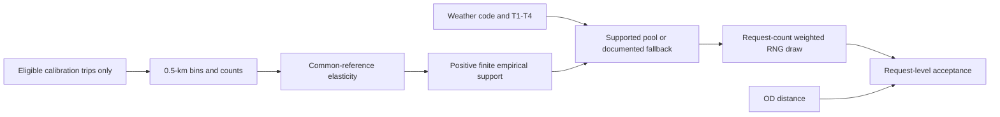

T1 is00–03, T2 04–05, T3 06–15 and T4 16–23 local time. Existing mapped group, T1 raw-weather pool, time pool and GLOBAL fallback ordering is retained with its support criteria. Temperature/wind conditioning was tested but worsened diagnostic RMSE from0.258529 to0.295726; it was not promoted. Complete CNN/sensitivity weather alignment is therefore **PARTIALLY_IMPLEMENTED**. Selection/grouping decisions have development exposure even when numerical pool estimates use Jan–Feb only.

The Jan1–Mar15 GLOBAL comparison has147 positive bins: uniform-bin mean/SD2.257965/0.339971 versus request-weighted1.715299/0.416015, support[1.356305,2.856160]. The current prospective Jan–Feb population instead has mean/SD1.725916/0.426314. These are different calibration populations. Conditional pools overlap and cannot be summed as disjoint population shares. [Disjoint assigned proportions](results_v2/publication/tables/sensitivity_group_proportions.csv), [pool statistics](results_v2/publication/tables/prospective_sensitivity.csv) and [weighting comparison](results_v2/publication/tables/sensitivity_weighting.csv) distinguish them.

Temporal support exceedance0.71–6.16% refers to positive validation **bin estimates**, not passenger proportions. It remains a limitation of finite training support. Empirical resampling is the selected implemented assumption; parametric fit evidence does not establish a final parametric family, and the master’s “ZIF” term remains unresolved.

Master equations(1)–(2), implemented by [price contract](src/pricing/slot_v3.py):

**R3a.**

$$
P_{gg't}^{\mathrm{disp}}=a_{gg't}P_0
$$

**R3b.**

$$
P_{c}^{\mathrm{raw}}=P_0+\frac{P_0}{\epsilon_c}\frac{L_{gg'}-L_0}{L_0}
$$

**R3c.**

$$
\mathrm{accept}_c=\mathbf{1}(P_{gg't}^{\mathrm{disp}}\leq P_c^{\mathrm{raw}})
$$

There is no minimum-price clamp on the acceptance threshold in this research contract. Nonpositive/nonfinite epsilon rejects; consistent km units enter the relative distance. Price factors derive from seven evenly spaced fare levels USD 6.60 through USD 94.70, divided by $P_0$; they are **not** the old0.85–1.15 action set. Conditioning and raw preference are private simulation inputs, not exposed individual DQN features.

Figures: [conditional empirical support](results_v2/publication/figures/sensitivity_conditional_support.svg), [weighting](results_v2/publication/figures/sensitivity_weighting.svg), [group shares](results_v2/publication/figures/sensitivity_group_counts.svg), [acceptance diagnostics](results_v2/publication/figures/sensitivity_acceptance.svg). The preserved [historical signed Record-029 histogram](results/analysis/2026-10-09_price_distance_sensitivity_record029_full_jan_mar/charts/authoritative_epsilon_histogram_full.png) depicts a different estimator and historical full-quarter scope; it is linked without reopening source rows and is not a current calibration figure. Historical trip-level summaries remain in the [binned comparison](results_v2/passenger_sensitivity/2026-11-17_binned_estimator_review/README.md); no trip-level density is reconstructed from summary moments.

## H. Top-level OD pricing DQN

Master §5.1 and [od_states](src/pricing/od_contract.py) define

**R4a.**

$$
s_{gg't}=[\hat J_{g,t},30\hat F_{g,t},I_{g,t},p_{g,t},\pi_{g',t}]\in\mathbb{R}^{13}
$$

**R4b.**

$$
p_{g,t}=[p_{g,t}^{(0)},\ldots,p_{g,t}^{(8)}]
$$

Demand, dispatch estimate and incoming passenger commitments are origin-specific counts. Routing probabilities sum to1 over valid actions; invalid neighbours have zero mass. Destination popularity is the existing discrete0/0.25/0.5/0.75/1 feature, rather than an asserted normalized probability over all destinations—an interpretation to preserve explicitly in alignment review. The active January observed support contains9,572 OD contexts. A strictly positive observed count is the current rule; a stricter significance threshold is not established.

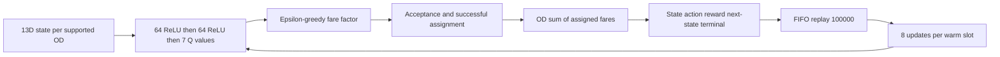

Master(3)–(4), [runtime](src/simulation/od_pricing_runtime.py), [reward checks](tests/test_joint_od_pilot.py):

**R5a.**

$$
R_{gg't}=\sum_{j:O_j=g,D_j=g'}P^{\mathrm{disp}}_{gg't}x_{jt}
$$

**R5b.**

$$
\max_\theta\mathbb{E}\!\left[\sum_t\gamma^t\sum_{g,g'}R_{gg't}\right]
$$

Here $x=1$ only for a successful assignment; units are USD. Slot reward sums assignment-time entries. Accepted-unmatched/rejected requests contribute zero. Valid unseen-OD reference-price revenue is system revenue but excluded from supported-OD learning rewards and replay. An assignment can still be physically in flight at terminal time; assignment revenue does not imply completed travel.

## I. Grid EWMA statistics

Master §6(5)–(8), [ewma](src/simulation/master_od_contract.py), [state integration](src/simulation/master_operational_state.py), [exact tests](tests/test_master_od_math.py): for successful fares $p_j$ in the preceding slot, count $N$ and observed charging wait $H$,

**R6a.**

$$
\mu_t=\alpha\bar p+(1-\alpha)\mu_{t-1}
$$

**R6b.**

$$
\sigma_t=\beta\frac{1}{N}\sum_j|p_j-\mu_{t-1}|+(1-\beta)\sigma_{t-1}
$$

**R7a.**

$$
\hat F_t=\delta\frac{N}{30}+(1-\delta)\hat F_{t-1}
$$

**R7b.**

$$
\hat H_t=\kappa H+(1-\kappa)\hat H_{t-1}
$$

$\mu,\sigma$ are USD; $\sigma$ is smoothed previous-mean absolute deviation, **not population SD**. $\hat F$ is dispatches/minute; waits and tolerances are minutes. Converting both waits to slots leaves their ratio unchanged. Current $\alpha=\beta=\delta=\kappa=0.3$ is retained experiment configuration, not the master’s illustrative0.125 or0.1–0.2 range. No-dispatch slots retain mean/deviation but decay frequency with observed count0. Missing charging wait retains its estimate; observed zero wait is a valid update. Raw zero deviation is retained, with a positive floor only at utility consumption.

## J. Private driver repositioning

Master §7(9)–(11), [OperationalRouting](src/routing/operational_interface.py):

**R8a.**

$$
U^1_{ig}=1-\Phi\!\left(\frac{P_i^{min}-\mu_g}{\max(\sigma_g,\sigma_{\mathrm{floor}})}\right)
$$

**R8b.**

$$
U^2_{ig}=1-\exp(-\hat F_gW_i^{max})
$$

**R9.**

$$
y_i=\arg\max_{g\in N_i}\{U^1_{ig}+U^2_{ig}-c_{\mathrm{km}}d_{ig}\}
$$

$P_i^{min}$ is USD, $W_i^{max}$ minutes, $d$ km and cost is normalized utility cost. This uses a normal-price/exponential-wait utility approximation, not an empirical claim that fare data are normal. Source conversion is metres/1000 before multiplying cost/km. Ties use deterministic action/station ordering. EV feasibility additionally preserves ability to reach a station. Numerical safeguards are $\sigma_{floor}=10^{-6}$ USD and $H_{floor}=10^{-6}$ minutes. Cost is $0.25d/(3\sqrt{2})$ for distance $d$ in km, using full path distance for charging. Initial dispatch frequency and charging wait are zero. The experiment’s [routing configuration](src/routing/configuration.py) is authoritative for numerical safeguards and movement-cost calibration; these are not manuscript constants.

The network observes aggregate169D state (nine triples of price mean/deviation/dispatch frequency plus142 charging-wait entries), while private preferences and energy determine local labels. This creates residual state/label non-identifiability. Earlier conflicting-label diagnostics cannot be erased by FedAvg convergence. The platform-facing response is aggregate probabilities, not raw preferences.

## K. EV charging and vehicle dynamics

Master(12)–(13), implemented in [charging navigation](src/routing/operational_interface.py):

**R10a.**

$$
U^3_{ig}=1-\exp\!\left(-\frac{H_i^{max}}{\max(\hat H_g,H_{\mathrm{floor}})}\right)
$$

**R10b.**

$$
D'_i=\arg\max_{g\in G_{\mathrm{charge}}}\{U^3_{ig}-c_{\mathrm{km}}d_{ig}\}
$$

$H_i^{max}=10$ minutes is explicit persisted **PROJECT_CALIBRATION**, not a source-derived numerical value; future5/10/20 sensitivity remains pending. EVs navigate when energy is at/below threshold, with feasible next-hop path and reserve checks. Non-EVs are exempt from battery-to-station reserve requirements under the mixed-fleet contract; normal arrival/travel validation remains. Travel duration is distance/speed with consistent elapsed-time units. Charging admission, queue and energy evolution are timed rather than instantaneous.

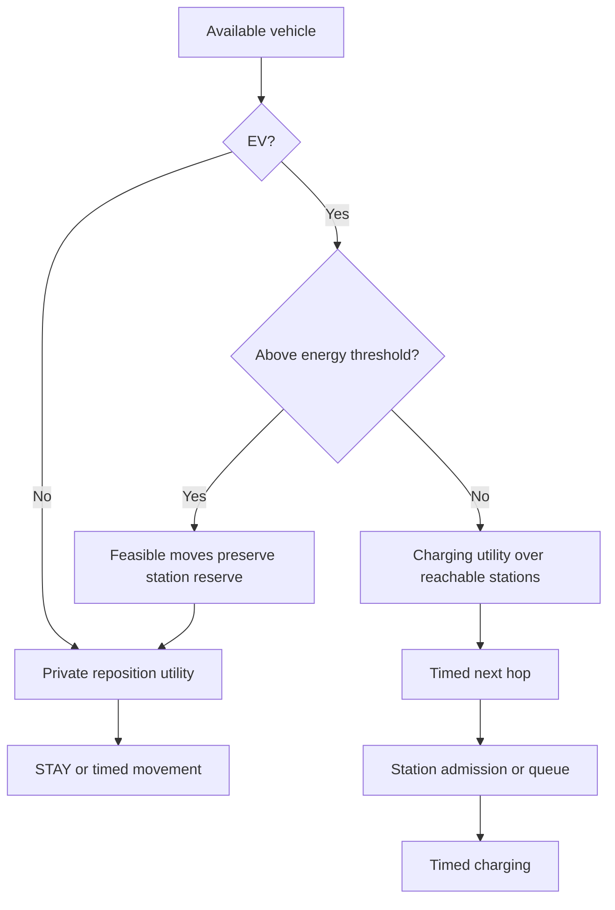

10%,20%,30% EV initialization is fixture-tested; only10% has bounded joint-learning evidence. Earlier four/16-slot runs recorded zero charging events. The latest two-episode pilot records3 and4 events; these are **event records, not seven completed sessions**. Reset censored231 passenger commitments and one charging occupant. Full charging-cycle coverage, continuous operation and penetration effects remain untested. See [mixed-fleet correction evidence](results_v2/federated_learning/2026-11-17_online_routing_retry_001/README.md) and [reset checks](results_v2/pricing_dqn/2026-11-20_multi_episode_orchestration/reset_checks.json).

## L. Federated learning and privacy

Master §8(19)–(21), [hierarchy](src/routing/research_hierarchy.py), [local learning](src/routing/learning.py), [federation tests](tests/test_multi_episode_federation.py):

**R11a.**

$$
p_{gk}=\frac{m_{gk}\exp z_{gk}}{\sum_l m_{gl}\exp z_{gl}}
$$

**R11b.**

$$
C_i=-\frac{1}{N_i}\sum_n\log p_{i,y_n}(s_n)
$$

**R12a.**

$$
\phi_i\leftarrow\mathrm{Adam}(\phi_i,\nabla C_i;0.001)
$$

**R12b.**

$$
\phi_{t+1}=\frac{1}{|A_t|}\sum_{i\in A_t}\phi_{i,t}^{\mathrm{local}}
$$

$m$ masks invalid neighbours; $A_t$ comprises clients with current-slot experience and an eligible local update. Equal-client weighting is the current research contract, not older sample-weighted offline FedAvg. The local169→64→32→9 network resets weights from global, retains its Adam state, and performs one update on the latest at most32 eligible observations from capacity1000 memory. The latest-minibatch rule is an experiment choice, not claimed uniform random sampling from the entire memory.

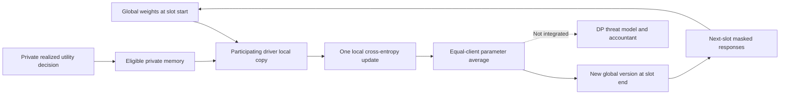

Fresh initialization and direct/indirect lineage guards reject incompatible historical routing weights. A completed-slot update is not visible to earlier decisions. Local preferences remain out of platform-facing summaries, but stored research checkpoints include private memory. **NONPRIVATE** means no differential-privacy guarantee: clipping/noise, threat model, accounting and privacy–utility experiments are not established by the existence of [legacy privacy code](src/routing/privacy.py).

## M. Gymnasium interface and slot sequence

[Gymnasium adapter](src/simulation/od_gymnasium.py) has bounded interface tests; the completed pilot uses the direct runtime orchestrator. Interface existence is not an independently validated full Gymnasium training campaign.

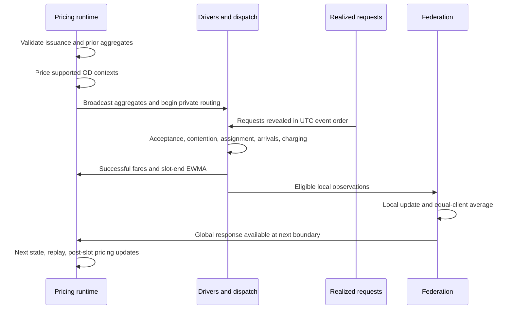

Forecast quantities never replace actual request counts. The current [replay implementation](src/simulation/historical_request_replay.py) orders requests stably by UTC pickup/source identity. See [dispatch implementation](src/dispatch/dispatch.py) for contention and eligibility, and [production adapter](src/simulation/final_production.py) for arrivals/charging. Multiple-decision reposition cadence, random eligible-driver contention interpretation and short-run versus continuous-operating implications must remain explicit rather than inferred from a high-level diagram.

## N. Training mathematics and hyperparameters

Master §10.3, [ODPricingDQN.train_step](src/rl/od_pricing_dqn.py), [mathematical tests](tests/test_master_od_math.py):

**R13a.**

$$
y=r+\gamma(1-d)\max_a Q_{\bar\theta}(s',a)
$$

**R13b.**

$$
\mathcal{L}(\theta)=\frac{1}{2M}\sum_m[y_m-Q_\theta(s_m,a_m)]^2
$$

**R14.**

$$
\bar\theta\leftarrow(1-\tau)\bar\theta+\tau\theta
$$

$M$ is minibatch size, $r$ is successful-dispatch reward in USD, $\theta$ denotes online weights, and $\bar\theta$ denotes target weights. $d$ is terminal, targets are gradient-stopped and the collected action $a_m$ indexes the online prediction. This follows the displayed Bellman equation; the master’s nearby prose about current-state argmax and its shorthand gradient line are not implemented as replacing collected actions or omitting the error gradient. Historical Huber paths remain separate.

Exploration (master§5.3/10.4): choose uniformly among seven actions with probability $e(u)$, otherwise choose maximum Q:

**R15.**

$$
e(u)=\max(0.1,1-0.005\lfloor u/10\rfloor)
$$

$u$ counts successful optimizer updates, not actions, slots or warm-up attempts. The schedule persists across episodes. Current validated settings: pricing13→64→64→7; Adam0.001; $\gamma=.99$; batch64; replay100000; warm-up1000; eight updates/warm slot; $\tau=.005$; seed42. Bellman/soft-update forms are required mathematics; the numerical settings are **EXPERIMENT_CONFIGURATION**. The master’s1.5×batch warm-up is illustrative, not the active1000 threshold.

## O. Experimental protocols and information boundaries

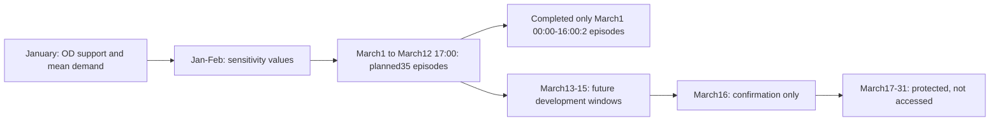

The approved35-episode budget spans280 elapsed hours/560slots, not all March1–12 local hours. March12 17:00–24:00 lies outside the selected training scope. Each episode is16slots. Physical fleet/energy/queues/commitments/priors reset; driver identity/EV membership and pricing/routing weights, optimizers, replay, private memories, counters and RNG persist. Terminal transitions have zero bootstrap; unfinished physical jobs are right-censored, not retroactively completed.

Development evaluation is planned after episodes7/14/21/28/35 on fixed March13 00–08, March14 08–16 and March15 16–24 windows. Frozen greedy policies disable both learners and isolate evaluation RNG/replay. Selection uses mean successful-assignment system revenue with earliest-checkpoint ties. Plateau/wall/RSS guards are frozen in [configuration](results_v2/pricing_dqn/2026-11-20_multi_episode_orchestration/frozen_configuration.json). These evaluations have **not executed**. March16 is development confirmation, not final testing. Historical design decisions already saw March evidence; chronological runtime isolation does not establish independent model-selection provenance.

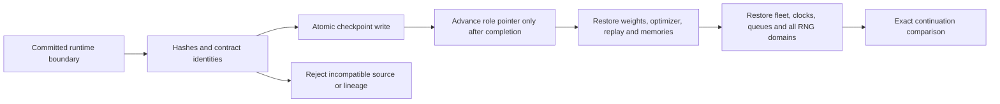

The [recovery result](results_v2/pricing_dqn/2026-11-20_multi_episode_orchestration/recovery_validation.json) verifies exact cross-episode reset and replay of episode2’s first slot, including losses/gradients. An earlier interrupted attempt retained eight committed slots; the environment-RNG reset wrapper was corrected before resuming. The uncommitted partial slot was rolled back and evidence preserved. This is not evidence that every later milestone/recovery path is already validated.

## P. Implementation traceability

**82 auditable requirement rows:**64 implemented/tested,1 implemented but not end-to-end validated,8 partial,1 configuration pending,2 not implemented in the active hierarchy and6 not evaluated. These counts summarize the review decomposition, not a claim that the master contains82 numbered requirements.

The [requirement matrix](results_v2/publication/tables/master_traceability.csv) records master section/equation, code, contract, test, evidence and limitation per requirement. [Status counts](results_v2/publication/tables/requirement_counts.json) are mechanically derived. `IMPLEMENTED_AND_TESTED` refers to the bounded requirement, not publication readiness. Other statuses distinguish unvalidated integration, partial methodology, pending configuration, missing implementation and unevaluated experiments.

| Module | Current assessment | Principal qualification |
|---|---|---|
| Data/grid/UTC replay | IMPLEMENTED_AND_TESTED | Trip proxy and spatial approximation |
| Causal CNN | IMPLEMENTED_AND_TESTED | Worse than baseline; assumed weather timing |
| Sensitivity | PARTIALLY_IMPLEMENTED | Reference and continuous-weather alignment |
| OD pricing/reward/Bellman | IMPLEMENTED_AND_TESTED | Bounded training only |
| EWMA/private utilities | IMPLEMENTED_AND_TESTED | Calibrations differ from illustrative guidance |
| Mixed EV/charging | IMPLEMENTED_AND_TESTED | Long-duration penetration studies NOT_EVALUATED |
| Online equal-client federation | IMPLEMENTED_AND_TESTED | NONPRIVATE |
| Privacy protocol | NOT_IMPLEMENTED in active hierarchy | Threat model/accountant pending |
| Gymnasium campaign | IMPLEMENTED_NOT_END_TO_END_VALIDATED | Adapter fixtures only |
| Full35-episode evaluation | NOT_EVALUATED | Only first2 completed |

The complete master text was inspected. Its contents lists §15 “Source traceability,” but the supplied body ends after §14 and final implementation order. No missing §15 text or equation numbers are fabricated. §13 checklist and §14 decision requirements are cross-referenced in the matrix rather than counted as independent evidence of completion.

## Q. Verified experiments and latest milestone

| Experiment | Verified outcome | Evidence |
|---|---|---|
| Historical CNN (superseded timing) | Original epoch100 and continuation200; baseline superior; incompatible timing/evaluation scope | [Original](results/analysis/2026-10-19_final_jan_mar_3km_cnn/README.md), [continuation](results/analysis/2026-10-19_final_cnn_performance_diagnosis/README.md) |
| Causal ReLU CNN | Best50/stop60; worse than mean baseline | [Training](results_v2/cnn_demand/2026-11-18_causal_research_training/README.md) |
| Softplus CNN | Best42/stop52; severe near-zero bias remains | [Training](results_v2/cnn_demand/2026-11-18_softplus_causal_research_training/README.md) |
| Final CNN diagnosis | Gradient saturation; freeze result | [Diagnosis](results_v2/cnn_demand/2026-11-18_softplus_final_diagnosis/README.md) |
| Binned/weighted sensitivity | Distinct estimand and count reconciliation | [Calibration](results_v2/passenger_sensitivity/2026-11-17_request_weighted_calibration/README.md) |
| Weather/distribution decision | Continuous extension not promoted | [Decision analysis](results_v2/passenger_sensitivity/2026-11-17_methodology_decision/README.md) |
| Prospective utility acceptance | 4,137eligible;996assignments;USD 21,934.508397;repeat/resume | [Acceptance](results_v2/simulation/2026-11-17_prospective_utility_acceptance/README.md) |
| Online routing/control | 19,342 local updates;4rounds;probabilities differ, physical totals match | [Routing/control](results_v2/federated_learning/2026-11-17_online_routing_rng_retry_002/README.md) |
| Joint four-slot pilot | 32pricingupdates;975assignments;exact repeat/resume | [Joint pilot](results_v2/pricing_dqn/2026-11-18_joint_learning_pilot/README.md) |
| March12 16-slot episode | 128pricingupdates;76,387routingupdates;4,119assignments | [Full development episode](results_v2/pricing_dqn/2026-11-20_full_episode_development/README.md) |
| Chronological episodes1–2 | 256pricingupdates;149,096routingupdates;32rounds | [Latest validated pilot](results_v2/pricing_dqn/2026-11-20_multi_episode_orchestration/validation.json) |
| Training/evaluation protocol |35episode budget; remaining33 not launched | [Decision packet](results_v2/pricing_dqn/2026-11-20_training_protocol_decision/README.md) |

The decision packet records its pre-approval state; the later orchestration report documents implementation approval. Historical V3 is **superseded methodology with retained provenance**, not evidence of current master-aligned OD performance. Its archived [review](results/analysis/2026-11-15_source_aligned_slot_pricing_v3/README.md) must not be merged into current learning curves. Earlier historical CNN results likewise have distinct feature timing and lineage; no causal comparison combines incompatible samples.

| Latest pilot | Episode1 | Episode2 |
|---|---:|---:|
| Eligible requests |30,359|38,486|
| Accepted / rejected |8,354 /22,005|9,864 /28,622|
| Assigned / accepted-unmatched |5,958 /2,396|8,876 /988|
| System revenue USD |133,576.496310|193,410.700636|
| Supported OD reward USD |133,241.183333|192,963.616667|
| Pricing updates |128|128|
| Ending exploration |0.940|0.875|
| Local routing updates |76,148|72,948|
| Charging event records |3|4|

Total revenue USD 326,987.196945 reconciles to supported reward USD 326,204.8 plus fallback USD 782.396945. The final replay holds100,000 of306,304 generated transitions;206,304 were FIFO-evicted. Retained replay is97.319% zero reward, representing9,572OD identities. Twenty-seven distinct prior focused tests passed, zero failed. Committed-slot execution was57.59minutes, excluding initialization/checkpoint/recovery and interrupted work; peak recorded RSS4.86GB and two retained checkpoints3.10GB. These are bounded resource measurements, not full-run forecasts.

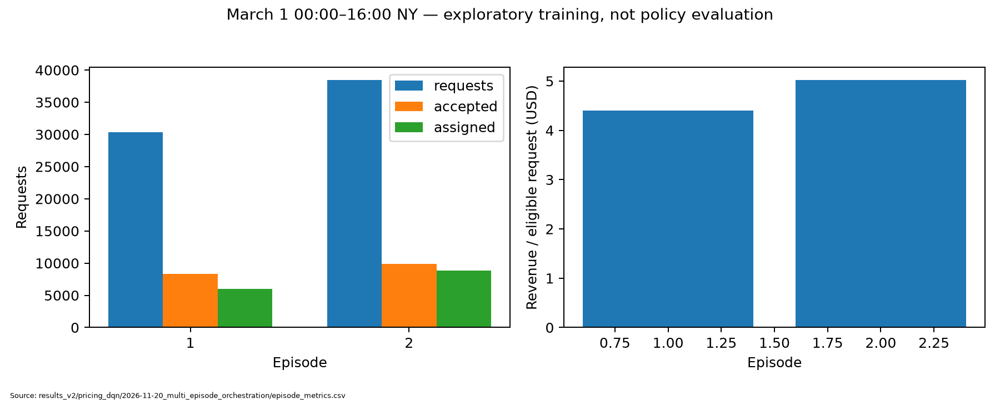

## Two-Episode Passenger Acceptance and Pricing

The authoritative March 1 training run is [multi-episode orchestration](results_v2/pricing_dqn/2026-11-20_multi_episode_orchestration/README.md), not an earlier March12 pilot or historical V3. Episode 1 spans 00:00–08:00 New York; Episode 2 spans 08:00–16:00 (05:00–21:00 UTC combined). Both contain 16 half-hour slots. The complete checkpoint audit ledgers were extracted without simulation, training, model inference or RNG reconstruction.

| Outcome | Episode 1 | Episode 2 | Total |
|---|---:|---:|---:|
| Eligible |30,359|38,486|68,845|
| Accepted |8,354|9,864|18,218|
| Passenger rejected |22,005|28,622|50,627|
| Assigned |5,958|8,876|14,834|
| Accepted but unmatched |2,396|988|3,384|
| Revenue (USD) |133,576.496310|193,410.700636|326,987.196945|

**Complete evidence:** [68,845 passenger rows](results_v2/publication/tables/two_episode_passenger_acceptance_details.csv), [data dictionary](results_v2/publication/tables/two_episode_passenger_acceptance_DATA_DICTIONARY.md), [all 32 slot summaries](results_v2/publication/tables/two_episode_slot_acceptance_summary.csv), [hashes and reconciliation](results_v2/publication/passenger_evidence_validation.json), [frozen configuration](results_v2/pricing_dqn/2026-11-20_multi_episode_orchestration/frozen_configuration.json), and [read-only exporter](scripts/export_two_episode_evidence.py).

The checkpoint records contain original individual sensitivity draws, offered prices, raw acceptance ceilings and dispatch outcomes. Decimal CSV values originate from exact hexadecimal checkpoint floats. All 32 ordered request-ID hashes match the saved reconciliation records. No required passenger field is missing; `NA` rejection reasons mean not applicable for accepted requests. Runtime source references are [request replay](src/simulation/historical_request_replay.py) and [OD pricing](src/simulation/od_pricing_runtime.py).

Acceptance uses the **recorded TLC trip distance converted from miles to kilometres**, not the OD distance matrix. Both acceptance distance and its source-distance equivalent are retained. The common references are 22.354198442390455 USD and 4.616983790655043 km. The raw ceiling follows equation R3 without a minimum-price clamp; all 68,845 stored ceilings reproduce exactly before CSV serialization. Seven supported-OD actions yield fares from 6.60 to 94.70 USD. The separate fallback factor 1.0 applies to 36 requests and is not an eighth DQN action. January–February request-weighted elasticity draws and their actual conditional-group labels are preserved.

Overall acceptance is 26.46%; assignment is 21.55% of eligible requests and 81.43% of accepted requests. Distance-band acceptance is 15.57%, 16.55%, 32.90%, 52.80% and 84.44% for [0,2), [2,5), [5,10), [10,20) and [20,infinity) km. These are descriptive observations under the configured formula, distance mixture and exploratory OD-slot actions, not causal willingness-to-pay estimates. Of 3,384 accepted-unmatched requests, 3,372 occurred at the lowest fare: high acceptance alone does not establish dispatch feasibility or revenue superiority.

Supported OD accounts for 68,809 requests and 326,204.80 USD reward. The 36 fallback requests include 35 accepted and assigned, one rejected, and 782.396945 USD revenue. Fallback revenue is separated from supported-OD learning reward. All 70,106 source rows reconcile to 1,261 eligibility exclusions and 68,845 eligible requests.

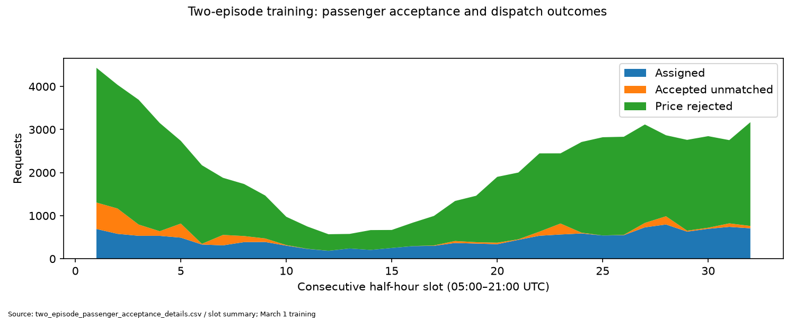

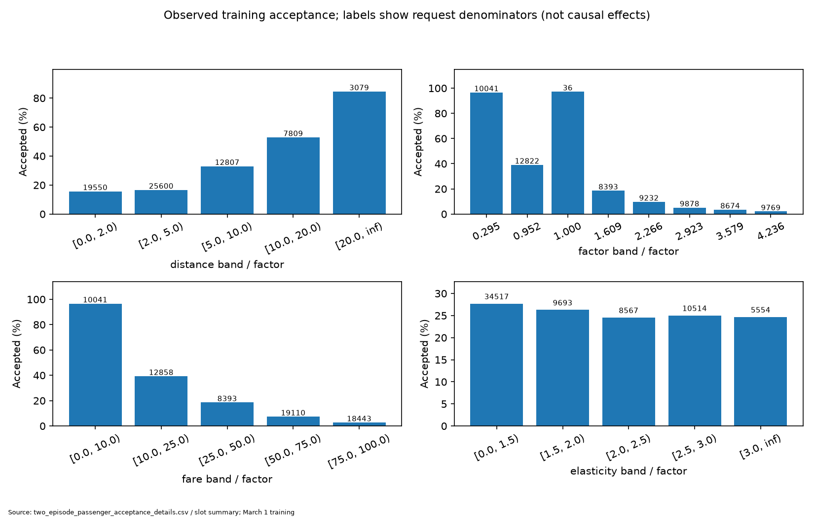

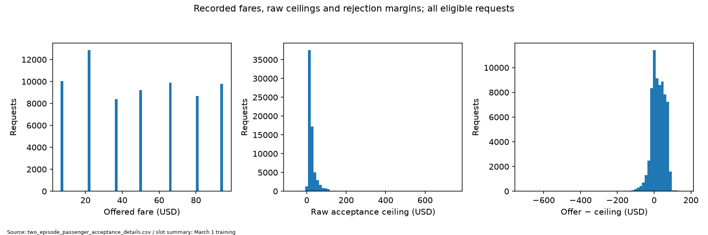

Per-stratum denominators are in [distance](results_v2/publication/tables/two_episode_acceptance_by_distance.csv), [factor](results_v2/publication/tables/two_episode_acceptance_by_factor.csv), [fare](results_v2/publication/tables/two_episode_acceptance_by_fare.csv), [elasticity](results_v2/publication/tables/two_episode_acceptance_by_elasticity.csv), [weather/time](results_v2/publication/tables/two_episode_acceptance_by_weather_time.csv) and [OD support](results_v2/publication/tables/two_episode_acceptance_by_od_support.csv). [Distribution statistics](results_v2/publication/tables/two_episode_price_distribution_statistics.csv) include raw ceilings and offer-minus-ceiling margins. Accepted-but-unmatched is distinguished from passenger rejection throughout. Slot-level means include fallback requests; the slot CSV records pre-decision exploration and per-slot optimizer counts.

## Research Figures and Tables Index

The [complete results inventory](results_v2/publication/tables/master_results_inventory.csv) maps master sections and requested review outputs to verified artifacts, partial evidence and missing comparisons. It complements the [82-requirement implementation matrix](results_v2/publication/tables/master_traceability.csv). Graphs are presentation artifacts, not additional experiments. The master source fingerprint matches the [reviewed full text](results_v2/publication/master_specification_excerpt.md); its absent section 15 body remains explicitly unresolved.

| Category | Verified evidence | Remaining limitation |
|---|---|---|
| CNN | [Loss](results_v2/publication/figures/cnn_training_loss.svg), [baseline metrics](results_v2/publication/figures/cnn_baseline_comparison.svg), [high/low grid series](results_v2/publication/figures/cnn_high_low_grids.svg), [city totals](results_v2/publication/figures/cnn_city_development.svg), [spatial and signed errors](results_v2/publication/figures/cnn_spatial_error.svg), [error distribution](results_v2/publication/figures/cnn_error_distribution.svg) | Below historical baseline; development is not final evaluation |
| Sensitivity | [Weighted CDF/support](results_v2/publication/figures/sensitivity_conditional_support.svg), [weighting comparison](results_v2/publication/figures/sensitivity_weighting.svg), [group proportions](results_v2/publication/figures/sensitivity_group_counts.svg) | Comparison populations differ explicitly; weather assumptions remain |
| Passenger pricing | [Complete passenger table](results_v2/publication/tables/two_episode_passenger_acceptance_details.csv), [slot summaries](results_v2/publication/tables/two_episode_slot_acceptance_summary.csv), [weather/time figure](results_v2/publication/figures/two_episode_weather_time_acceptance.svg) | Training description; no policy superiority claim |
| DQN | [Exploration/loss/replay](results_v2/publication/figures/dqn_learning_replay.svg), [episode rewards](results_v2/publication/figures/dqn_episode_outcomes.svg) | Only episodes 1–2 completed |
| Routing/FedAvg | [Update progression](results_v2/publication/figures/federation_progress.svg), [earlier March12 control](results_v2/publication/figures/routing_control.svg) | NONPRIVATE; control is a separate experiment |
| Fleet/charging | [Validation](results_v2/pricing_dqn/2026-11-20_multi_episode_orchestration/validation.json) | Single 10% EV fleet; seven event records do not establish completed cycles; waits/SOC trajectories not exported |
| Reproducibility | [Recovery](results_v2/pricing_dqn/2026-11-20_multi_episode_orchestration/recovery_validation.json), [source hashes](results_v2/publication/passenger_evidence_validation.json), [new figure manifest](results_v2/publication/tables/passenger_evidence_figure_manifest.csv) | Final protected and privacy/EV comparisons pending |

## R. Benchmark interpretation

The historical-average forecast beats both causal CNN variants on identical saved validation/development samples. The matched routing control establishes changed response estimates with identical physical outcomes while pricing learning was disabled. It does not establish no value from hierarchy. The two episode revenues concern different time windows under exploration and cannot be interpreted as policy improvement.

No final fixed-price, myopic-pricing or trained-policy benchmark is reported as completed. No statistical significance or multi-seed generalization is claimed. Full EV10/20/30 comparison and privacy–utility trade-offs remain NOT_YET_EVALUATED. [Routing control table](results_v2/publication/tables/routing_control.csv), [control figure](results_v2/publication/figures/routing_control.svg), [learning/replay diagnostics](results_v2/publication/figures/dqn_learning_replay.svg), [federation progress](results_v2/publication/figures/federation_progress.svg) and [reward/charging reconciliation](results_v2/publication/figures/simulation_reconciliation.svg) show only recorded quantities.

## S. Methodological decision register

| Decision | Classification | Rationale / qualification |
|---|---|---|
|3-km grid; OD identity; successful-dispatch objective|MASTER_REQUIRED|Derived valid geometry and supported pairs; not legacy grid reuse|
|30-minute slots;120-second mini-slots|EXPERIMENT_CONFIGURATION|Master examples adopted explicitly|
|UTC elapsed/New York features|EXPERIMENT_CONFIGURATION|Avoid nonexistent civil slots and duration errors|
|Observed TLC OD replay|EXPERIMENT_CONFIGURATION|Preserves requests in selected windows; trips proxy demand|
|January positive OD support/fallback|PROVISIONAL_ASSUMPTION|No empirically selected stricter threshold|
|0.5-km distance bins|EXPERIMENT_CONFIGURATION|Preserved documented analysis resolution|
|Request-count empirical weighting|EMPIRICALLY_SELECTED|Represents observed mixture; comparison evidence, not causal identification|
|Common reference values|PROVISIONAL_ASSUMPTION|Construction differs from master selection prescription|
|Weather/T1–T4 fallback|EMPIRICALLY_SELECTED|Inherited support/stability decisions; development exposure|
|Positive empirical tails|PROVISIONAL_ASSUMPTION|No extrapolation; validation exceedance unresolved|
|Seven CNN features|MASTER_REQUIRED|Continuous-weather alignment incomplete downstream|
|120-minute weather lag|PROVISIONAL_ASSUMPTION|Not verified publication timing|
|Historical mean as active demand input|EXPERIMENT_CONFIGURATION|Cutoff-safe engineering arm; CNN underperforms|
|13D OD state and seven fare-derived actions|EXPERIMENT_CONFIGURATION|Master structure, selected discretization and popularity encoding|
|EWMA recurrence/Bellman objective|MASTER_REQUIRED|Explicit safe no-observation/terminal handling|
|EWMA0.3;gamma.99;tau.005|EXPERIMENT_CONFIGURATION|Not manuscript-derived calibrations|
|Equal-client FedAvg|MASTER_REQUIRED|Active-client set and Adam work are selected implementation choices|
|NONPRIVATE mode|EXPERIMENT_CONFIGURATION|No claim of privacy compliance|
|5000vehicles;10%pilotEV|EXPERIMENT_CONFIGURATION|20/30% effect comparisons pending|
|Replay100000;8updates/slot;warm-up1000|EXPERIMENT_CONFIGURATION|Retained tested settings, not convergence guarantee|
|Staircase exploration;35episode horizon|EXPERIMENT_CONFIGURATION|Approved bounded protocol; only2episodes executed|
|Physical reset/learning persistence|EXPERIMENT_CONFIGURATION|Terminal censoring limits continuous-operation interpretation|
|Three checkpoint roles/all RNG restoration|EXPERIMENT_CONFIGURATION|Atomic retention and exact bounded recovery|

## T. Open Methodological Decisions and experimental limitations

Genuine unresolved decisions are: final reference construction justification; continuous-temperature/wind sensitivity alignment; empirical-tail adequacy and meaning of “ZIF”; stricter OD significance and popularity interpretation; verified decision-time weather availability; final privacy threat model/mechanism/accountant; final benchmark and independent protected evaluation protocol; and scientific adequacy of physical resets for charging studies. No new choice is made in this review.

Known limitations are distinct: CNN underperformance is observed, not a reason to force a new model; the CNN-versus-historical-mean downstream study has not run; only one seed and bounded joint learning exist; charging records do not establish complete charging cycles;10/20/30EV outcomes are absent; later evaluation/continuation paths have not been demonstrated with real data. The35episode development schedule is already configured, but final publication evaluation remains pending. Research readiness does not mean deployment readiness.

The recommended next single task is **review and accept this methodology/evidence boundary before authorizing continuation**. This review does not launch episodes3–7, extend training, change hyperparameters or resolve scientific choices implicitly.

## U. Reproducibility and execution reference

Use the existing `ridehailing-phd` Python environment. [Dependencies](requirements.txt) describe the project; causal CNN evidence records TensorFlow2.16.2. Recreating an environment from scratch was not tested in this review. [Review provenance](results_v2/publication/review_provenance.json) records Git HEAD and pre-existing modifications; HEAD alone is insufficient for a dirty worktree. [Pilot source manifest](results_v2/pricing_dqn/2026-11-20_multi_episode_orchestration/implementation_sources.json) and [figure source hashes](results_v2/publication/figure_sources.json) bind actual evidence.

Directory roles: `src/` implementation; `scripts/` entry points; `tests/` focused tests; `data/processed/` versioned input artifacts; `models/` checkpoints; `results/` preserved historical research; `results_v2/` newer contract/evaluation evidence; `results_v2/publication/` this documentation-only review’s tables and figures.

Safe review regeneration from repository root (no inference/training):

```sh
conda activate ridehailing-phd
MPLCONFIGDIR=/tmp/causal_cnn_mpl python -B scripts/build_research_review.py
python -B scripts/build_research_traceability.py
python -B -m unittest tests.test_research_review_documentation -v
```

The figure builder reads saved CSV/JSON and validation/March16 forecast exports, checks count-unit metrics and reconciliation, and writes SVG/PNG plus tables. It never loads model weights or protected evaluation labels. Figure source/caption manifest is [here](results_v2/publication/tables/figure_manifest.csv).

Historical executed entry points, **reference only, do not run during this review**: [ReLU trainer](scripts/train_causal_research_cnn.py), [Softplus trainer](scripts/train_softplus_research_cnn.py), [full development runner](scripts/run_full_od_development.py), [pilot primary/resume/recover](scripts/run_multi_episode_od_pilot.py). Their existing output guards and code/contract hashes apply; these are not promises of a clean-machine full reproduction. Future [continuation](scripts/continue_multi_episode_od.py) requires explicit authorization and verified checkpoint/output arguments; its full33episode campaign is unverified and unexecuted.

The [latest pilot checkpoint inventory](results_v2/pricing_dqn/2026-11-20_multi_episode_orchestration/validation.json) and [episode1 milestone recovery report](results_v2/pricing_dqn/2026-11-20_multi_episode_orchestration/recovery_validation.json) describe the retained full-state checkpoints. Three roles (`latest`, `best`, `milestone`) plus one staging generation are allowed; no `best` exists before evaluation. Checks require50GiB reserve plus20GiB projected write, ≤100GiB run storage,16GiB RSS and96hour wall guard. Prior historical payload consolidation left some tombstones non-resumable; [retention evidence](results_v2/repository_maintenance/2026-11-18_checkpoint_consolidation/README.md) is authoritative. No removed payload is offered as a runnable checkpoint.

## V. Supporting evidence and review validation

- [Master requirement matrix](results_v2/publication/tables/master_traceability.csv): source sections, code/symbol context, contracts, tests, evidence and limitations.
- [Evidence index with hashes](results_v2/publication/tables/evidence_index.csv): finite authoritative report set.
- [Requirement counts](results_v2/publication/tables/requirement_counts.json): implementation versus pending scope.
- [Documentation validation](results_v2/publication/documentation_validation.json): local links, source paths, figures, chronology and preservation checks.
- [Completed episode table](results_v2/publication/tables/completed_episode_results.csv), [CNN metrics](results_v2/publication/tables/cnn_metrics.csv), [city predictions](results_v2/publication/tables/cnn_city_counts.csv), [prospective sensitivity](results_v2/publication/tables/prospective_sensitivity.csv).
- [Nine editable diagrams](results_v2/publication/diagrams): extracted Mermaid source matching this README.

[Rendering repair validation](results_v2/publication/readme_render_validation.json) records Markdown parsing, math checks, image decoding and local anchors. The complete document has a [structural HTML preview](results_v2/publication/readme_structural_preview.html); this is not a GitHub MathJax/Mermaid visual pass. Full browser rendering remains unverified because those engines are unavailable locally.

All numerical figures use persisted sources. No missing charging completion, repositioning-cost, historical density or final benchmark points are invented. Publication figures are descriptive; SVG versions are editable. Mermaid rendering is validated only to the extent reported in the validation artifact, not assumed from code-fence presence. The package supports academic methodology review **with the stated unresolved items**, not a declaration of full master compliance or publishable performance superiority.
