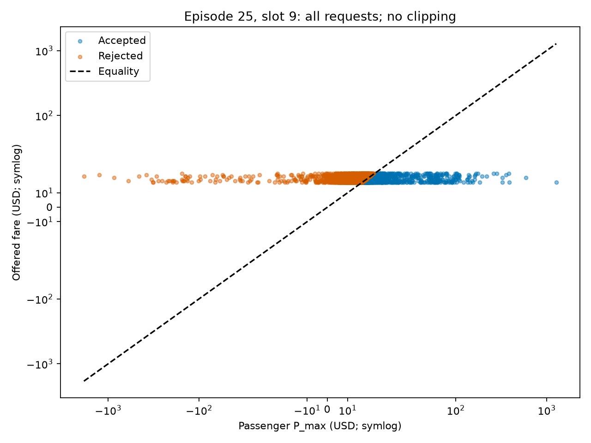
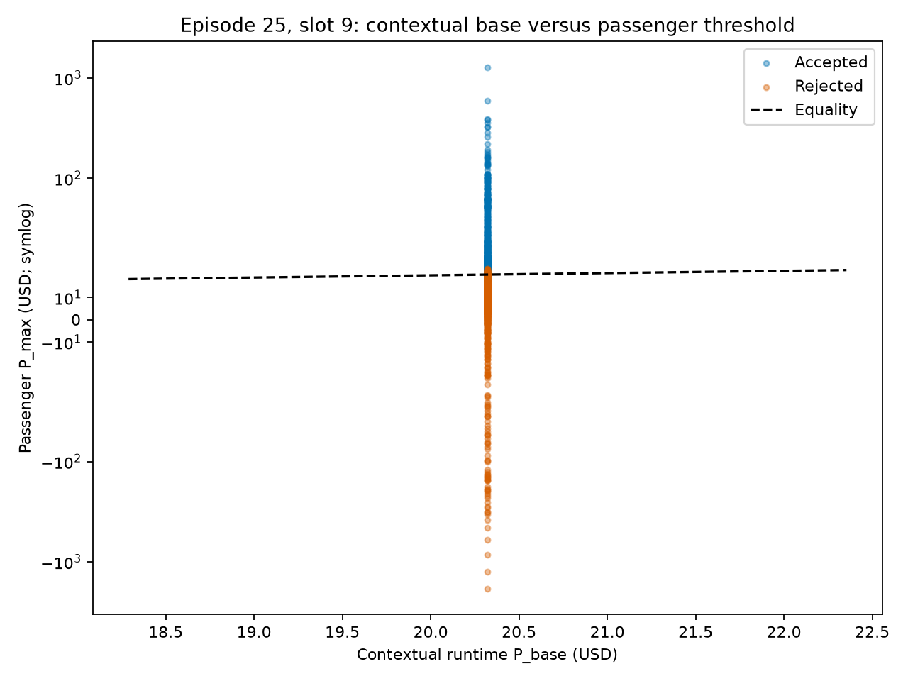
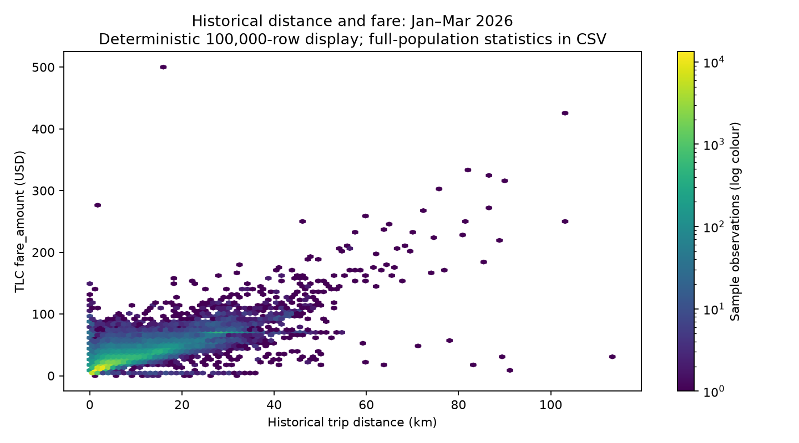
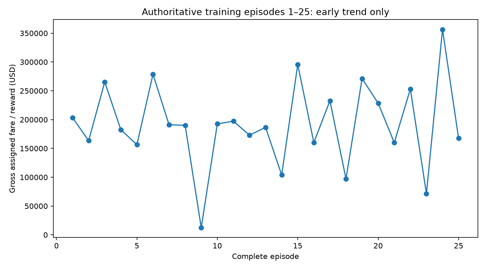
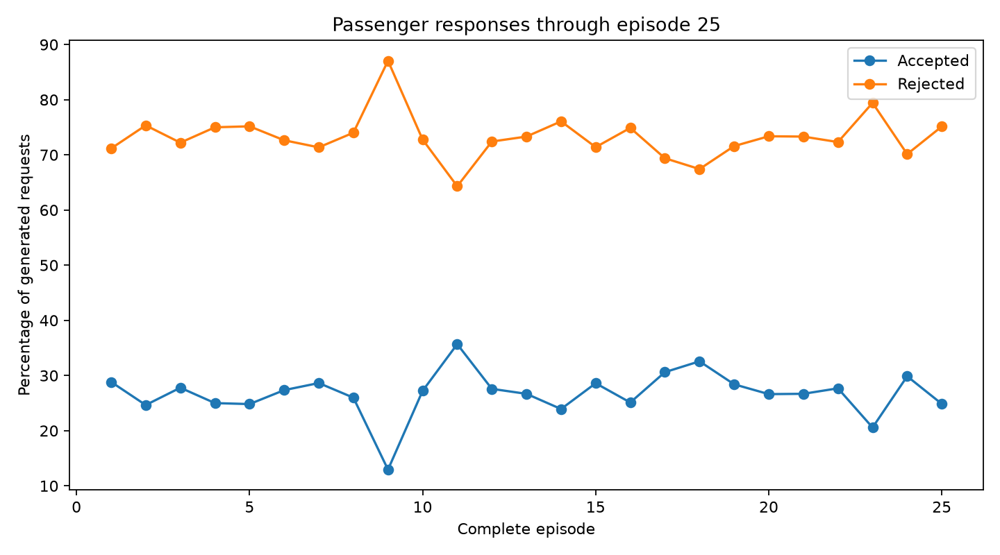
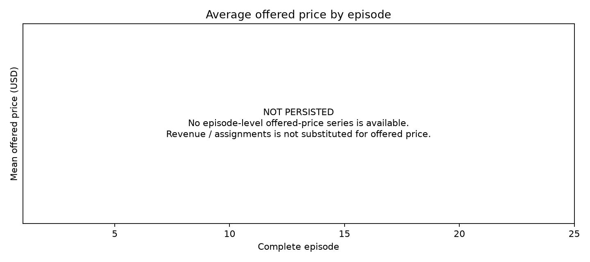
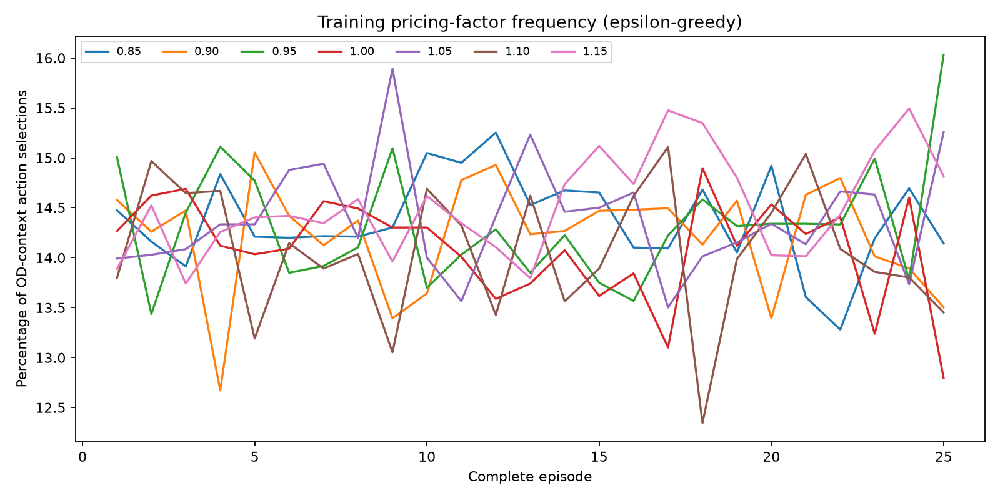
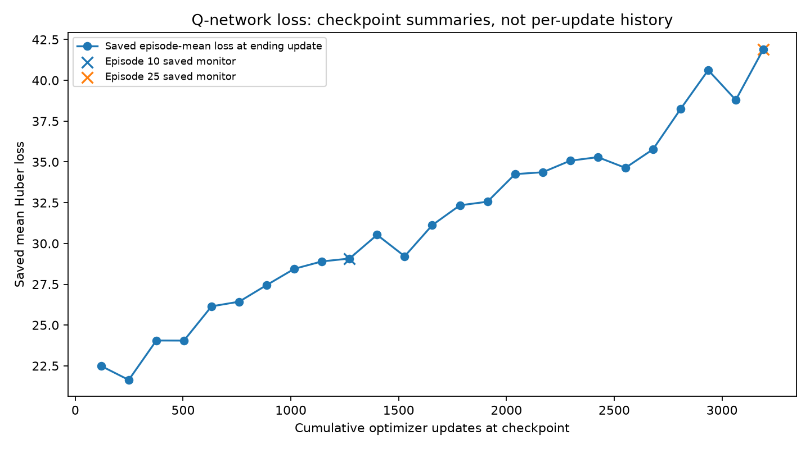
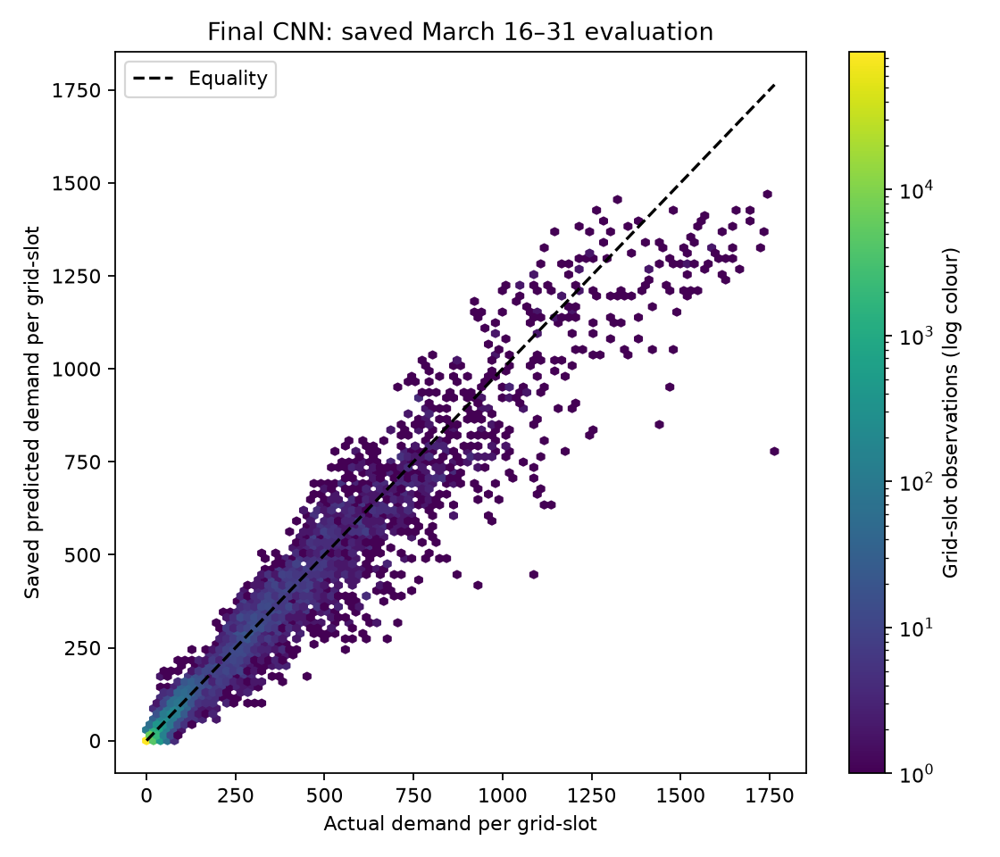
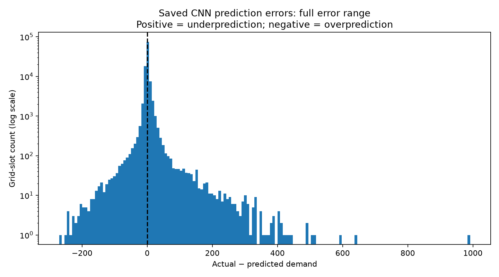

# Academic Review Validation Package

## Latest pricing status

See the [canonical V1 README](../2026-11-07_passenger_sensitive_pricing_v1/README.md) for all methodology and results. Training through Episode25: technical PASS, numerically stable, learning signal YES; policy stability NO, convergence NO. Action-dominance risk HIGH; dynamic value UNRESOLVED. Further training AWAITING_ACADEMIC_REVIEW. Protected final evaluation untouched.

Earlier validation history — pricing statements below are superseded, not current instructions

## 1. Scope

This package validates the current implementation against the newly available consolidated DQN pricing roadmap. It contains one exact reconstruction of a historical training slot, historical descriptive statistics, and existing DQN/CNN/DP evidence. No methodology, frozen model, driver profile, production source, training protocol or checkpoint was changed. No optimizer update, retraining, hyperparameter search or long training resume occurred. The single reconstructed slot inserted transitions only into a disposable in-memory replay buffer; nothing was saved back to the learner namespace.

The complete cleaned Jan–Mar historical population is permitted for descriptive analysis. The already-defined CNN test predictions are also permitted. March17–31 remains untouched by hierarchical RL training, routing training, policy selection, integrated simulation or final service/revenue evaluation. Those boundaries differ from historical data analysis and CNN-only evaluation.

## 2. Current Architecture

True 3 km grid (142 valid cells, 16×16 raster) → saved CNN forecasts → public 13D pricing state → 13→64→64→7 DQN → seven factors 0.85/0.90/0.95/1.00/1.05/1.10/1.15 → contextual empirical passenger P_max → inclusive passenger acceptance → independent driver-price, local supply and EV feasibility → deterministic FCFS assignment → movement, timed charging and operational updates.

The frozen temporal-FedAvg 169→64→32→9 routing network supplies probabilities to the pricing state. Physical reposition/charging actions still use the existing operational utility decisions. Pricing selects one action per observed OD pair per half-hour and reuses it for requests with that OD. Reward is the sum of gross successfully assigned fares at assignment time; rejected and accepted-unmatched requests contribute zero. This is DQN, not a bandit or actor–critic learner.

## 3. Distance-Unit Validation

**NO_ISSUE_UNIT_INVARIANT.** All new review distances use km; TLC source miles appear only as explicit raw provenance. The historical global L_base is **4.856998243316242 km**; the 3 km grid cell side is a separate geometric quantity.

A deterministic first-10,000-row historical sample contains 9,992 VALID epsilon rows. Converting both trip and reference distances to km gives relative-deviation maximum/mean absolute differences 1.77636e-15/6.21e-17, with zero discrepancies above 1e-12. Epsilon differences peak at 4.14957e-12; three exceed an absolute-only 1e-12 test because of denominator amplification, but **zero fail combined relative/absolute 1e-12 tolerance**. Native-unit epsilon exactly reproduces the stored sample.

For all 2,996 selected runtime requests, independent km-based P_max differs from recorded P_max by at most 1.13687e-13 USD (mean 1.17515e-15); zero tolerance failures or decision changes. Grid geometry is EPSG:32118, native metres, verified 3.0×3.0 km; cardinal/diagonal/STAY movement is 3.0/4.242640687119286/0 km. No numerical unit correction or unit-driven retraining is indicated. See `distance_unit_validation.json`.

## 4. Historical vs Runtime Pricing References

| concept | historical_Record029 | runtime | same_or_different | why | methodological_impact |
| --- | --- | --- | --- | --- | --- |
| P_base | One global 21.34586956773507 USD | Resolved contextual mean fare; selected slot 20.321533859249936 USD | DIFFERENT | Exact WeatherCode × half-hour context, then period/weather/global fallback | A historical global base must not replace the runtime base |
| L_base_km | Price-conditioned global 4.856998243316242 km (479,000 reference trips) | Resolved contextual mean trip distance; selected slot 5.289170703620971 km | DIFFERENT | Runtime reference is the context mean, not the historical ±$1 subset | Reference-distance changes alter P_max even though unit conversion does not |
| epsilon definition | Signed relative_price_deviation / relative_distance_deviation | Positive abs(relative_distance_deviation / relative_price_deviation) | DIFFERENT | Reciprocal orientation plus absolute value and different reference population | Historical signed epsilon cannot be inserted directly into runtime P_max |
| epsilon sampling | Historical empirical distribution; archived support decisions | Uniform empirical row resampling with replacement within resolved pool | DIFFERENT | Duplicate-value frequencies preserved; caller-owned NumPy RNG | No Gaussian approximation, artificial floor or historical support substitution |
| P_max equation | Rearranging historical signed definition gives P_base*(1+epsilon_historical*r_distance) | P_base*(1+r_distance/epsilon_runtime), exactly the roadmap equation | DIFFERENT_EPSILON_CONVENTION | Historical epsilon and runtime epsilon have different definitions | FORMULA_ALGEBRA_EQUIVALENT refers to runtime versus roadmap, not interchangeable historical epsilon |
| Units | TLC miles in source; all reported distances converted to km | Trip and contextual reference both miles internally; km reporting | UNIT_INVARIANT | Same conversion in numerator/reference cancels | No numerical unit correction or retraining indicated |
| Denominator treatment | Strict distance gap <0.00804672 km unresolved; rows retained | Runtime positive empirical epsilon, no positive-epsilon floor or clipping | DIFFERENT | Historical resolution rule does not redefine current behavioural sampler | No silent transfer of historical filtering/support into runtime |

**FORMULA_ALGEBRA_EQUIVALENT = YES** means runtime versus the roadmap equation with the runtime epsilon convention. **REFERENCE_CONVENTION_IDENTICAL = NO**. These are separate statements. The reciprocal signed historical epsilon is not interchangeable with the positive runtime epsilon. Full derivation and source hierarchy are in [methodology_reconciliation.md](methodology_reconciliation.md).

## 5. Request-Level Pricing Fixture

**Episode25, slot9 (one-based), 2026-03-12 15:30:00–16:00**, source March12 within the training period. Reconstruction began at the committed slot8 checkpoint `models/pricing_dqn/final_nonprivate_multiepisode_seed42/episode_0025/checkpoint_0008_98717f4d`. Environment seed **3405943863**, learner seed **42**, saved optimizer updates **3128**, epsilon-greedy exploration **0.940568**. The exploration probability is distinct from the per-request behavioural epsilon.

All checkpoint payload hashes passed before and after. Simulator, learner and request/customer/Python/NumPy RNG states were restored. All comparable saved slot fields matched exactly, including requests, acceptance, assignments, fare reward, replay size, routing actions and charging decisions. No optimizer update was executed; online weights were checked unchanged. Post-slot optimizer fields are intentionally not reproduced. No later slot was replayed.

`request_level_pricing_full.csv` contains **2,996 actual generated requests**, with every required field and observational feasible-driver counts. `request_level_pricing_review_sample.csv` has **300** deterministic rows, stratified by actual outcome, factor and P_max/base relation before filling by evenly spaced rows. It is an inspection sample, not a population-weighted estimator. All seven factors and the existing accepted/rejected/accepted-unmatched categories are represented.

`L_GG_km` is the intact empirical requested trip distance, **not centroid displacement or grid-cell side**. `Timestamp` is the slot start; request IDs preserve the restored run identity. Runtime references in this slot are P_base=20.3215338592499 USD and L_base=5.28917070362097 km. Provenance and exact saved-report comparisons are in `request_fixture_provenance.json`.

## 6. Passenger Acceptance Validation

Active rule: **ACCEPT iff P_offer ≤ P_max**; equality accepts. Recorded outcomes are retained separately from independent recomputation using the km-converted distance terms. Decisions have no comparison tolerance. Approximate categories elsewhere use absolute 1e-9 USD only for descriptive reporting.

Requests **2,996**; accepted **719 (23.998665%)**; rejected **2277 (76.001335%)**. **Decision mismatches: 0. Exact equality cases: 0. Missing or nonfinite numeric fields: 0.** Equality behavior is verified from the inclusive code rule; this slot has no empirical equality case. Offered fares equal contextual base × selected factor. P_max has 165 negative values; the unchanged signed distance term permits them, and no clamp was introduced.

## 7. Offered Price vs P_max

| min_USD | P5_USD | median_USD | P95_USD | max_USD | mean_USD |
| --- | --- | --- | --- | --- | --- |
| -1260.06 | -26.808 | 5.79806 | 21.6088 | 1871.34 | 5.42691 |

P_offer below / approximately equal / above P_max: **719 / 0 / 2277**. The plot includes every request and an equality line. Symmetric-log axes preserve negative and extreme P_max values without clipping. A discount relative to base can still be rejected when the offered fare exceeds that passenger's threshold.

## 8. P_base vs P_max

| category | N | percentage | acceptance_percentage | mean_trip_distance_km | median_trip_distance_km |
| --- | --- | --- | --- | --- | --- |
| BELOW | 2365 | 78.9386 | 5.5814 | 2.30157 | 2.14043 |
| APPROX_EQUAL | 0 | 0 | — | — | — |
| ABOVE | 631 | 21.0614 | 93.0269 | 11.6097 | 8.72264 |

Pricing-factor counts by category:

| category | 0.85 | 0.9 | 0.95 | 1.0 | 1.05 | 1.1 | 1.15 |
| --- | --- | --- | --- | --- | --- | --- | --- |
| BELOW | 427 | 512 | 377 | 55 | 528 | 261 | 205 |
| APPROX_EQUAL | — | — | — | — | — | — | — |
| ABOVE | 156 | 117 | 67 | 63 | 67 | 59 | 102 |

With positive runtime epsilon, the sign of P_max−P_base equals the sign of trip distance−runtime L_base. Most trips in this selected slot are below the **contextual** reference distance; that is sufficient to explain P_max below base without invoking a unit bug. No historical global base was substituted.

## 9. Historical Distance vs Fare

All **10,620,409** cleaned Jan–Mar trips are used, retaining the existing 0<source distance≤100 raw miles validity decision (maximum equivalent 160.9344 km). TLC `fare_amount` is USD. Conversion to km precedes all bins and short-trip counts. Intervals are `(lower, upper]`; final bin is `>15 km`. No epsilon validity/support filter is applied to this descriptive source analysis.

| distance_bin_km | N | mean_trip_distance_km | median_trip_distance_km | mean_fare_USD | median_fare_USD | min_fare_USD | P10_fare_USD | P90_fare_USD | max_fare_USD | unique_fare_values |
| --- | --- | --- | --- | --- | --- | --- | --- | --- | --- | --- |
| 0–1 | 901393 | 0.678405 | 0.772485 | 10.0844 | 6.5 | 0.01 | 4.4 | 18.19 | 1000.03 | 8056 |
| 1–2 | 2403813 | 1.51275 | 1.51278 | 10.1547 | 8.6 | 0.01 | 6.5 | 14.62 | 890 | 5959 |
| 2–3 | 1946097 | 2.47047 | 2.4462 | 13.9956 | 12.19 | 0.01 | 9.3 | 19.8 | 581 | 6486 |
| 3–3.17 | 247751 | 3.07654 | 3.05775 | 16.2668 | 14.2 | 0.01 | 11.4 | 22.6 | 199.9 | 4606 |
| 3.17–4 | 1026012 | 3.5467 | 3.54056 | 18.0035 | 16.3 | 0.01 | 12.8 | 25.19 | 250 | 6700 |
| 4–5 | 827565 | 4.46258 | 4.44179 | 21.0957 | 19.1 | 0.01 | 14.9 | 29.54 | 300 | 7091 |
| 5–7.5 | 1088715 | 6.09063 | 6.00285 | 25.5276 | 23.3 | 0.01 | 17.7 | 35.23 | 480.9 | 8072 |
| 7.5–10 | 569702 | 8.64558 | 8.5778 | 30.9289 | 28.5 | 0.01 | 22.6 | 41.89 | 496.5 | 7853 |
| 10–15 | 678050 | 12.3666 | 12.2793 | 37.2672 | 35.2 | 0.01 | 28.16 | 49.2 | 900 | 8403 |
| 15+ | 931311 | 23.8391 | 22.4343 | 59.404 | 56.5 | 0.01 | 38.74 | 75.98 | 2555.2 | 12132 |

Distance distribution (km):

| min | P1 | P5 | P25 | median | P75 | P95 | P99 | max | mean |
| --- | --- | --- | --- | --- | --- | --- | --- | --- | --- |
| 0.0160934 | 0.241402 | 0.804672 | 1.73809 | 3.04166 | 6.16379 | 20.3099 | 31.4788 | 160.822 | 5.58293 |

Short-trip counts:

| maximum_trip_distance_km | N |
| --- | --- |
| 1 | 901393 |
| 2 | 3305206 |
| 3 | 5251303 |
| 3.17 | 5499054 |

The density display uses 100,000 deterministic evenly spaced source rows for readability; **all table statistics use the full population**. Earlier mile-based analyses were numerically valid, but do not by themselves answer the distinct 3–3.17 **km** question.

## 10. Fare-Floor Investigation

The data do **not** support constant fares throughout distances below 3 km. Median fares increase from **$6.50** (0–1 km) to **$8.60** (1–2 km) and **$12.19** (2–3 km); corresponding means are $10.0844/$10.1547/$13.9956. The **3–3.17 km** bin contains **247,751 trips**, mean **$16.266758**, median **$14.20**, P10/P90 **$11.40/$22.60**, and **4,606 distinct fares**. The adjacent 3.17–4 km bin has median $16.30. These summaries show a rising distance/fare pattern, not evidence of a unique structural break exactly at 3 or 3.17 km.

Below 3 km there are **8,719 distinct fares** and a broad distribution. Repeated exact fares occur across many short distances:

| fare_USD | N | percentage_short | unique_trip_distances | minimum_trip_distance_km | maximum_trip_distance_km |
| --- | --- | --- | --- | --- | --- |
| 8.6 | 368907 | 7.02506 | 185 | 0.0160934 | 2.99338 |
| 7.9 | 367309 | 6.99463 | 169 | 0.0160934 | 2.89682 |
| 9.3 | 361882 | 6.89128 | 186 | 0.0160934 | 2.99338 |
| 7.2 | 350446 | 6.67351 | 161 | 0.0160934 | 2.99338 |
| 10 | 347816 | 6.62342 | 186 | 0.0160934 | 2.99338 |

Repeated fares are consistent with discrete metering, rounding or heterogeneous fare schedules; they do not establish a single minimum-fare rule. Retained minimum fares of $0.01 and wide maxima also rule out asserting a universal positive floor from these summaries. No tariff/legal claim, source removal or pricing-rule change is made. A formal structural-break or tariff-origin study would be separate work.

## 11. Driver Price Preference

**ACTUAL_IMPLEMENTATION:** `src/dispatch/dispatch.py::find_eligible_vehicle` requires **P_offer ≥ driver.price_preference**, equality eligible, after local availability/energy/reserve checks. `src/routing/production.py::generate_driver_profiles` creates one persistent preference per driver from **Uniform(max(0, μ−σ), μ+σ)** using seed42, not 0.85×contextual P_base. Metadata records μ=$20.233906794701575, population σ=$16.299856940413804, bounds **$3.934049854287771–$36.53376373511538**, from 2,898,376 valid pre-cutoff fares. All **5,000** profiles persist unchanged.

| min_USD | P1_USD | P5_USD | median_USD | mean_USD | P95_USD | P99_USD | max_USD |
| --- | --- | --- | --- | --- | --- | --- | --- |
| 3.95096 | 4.31882 | 5.59532 | 19.9726 | 20.0909 | 34.8666 | 36.2485 | 36.5261 |

For this slot there is one actual contextual P_base, **$20.3215338592499**. Each of the 5,000 preferences is normalized once against that base, not the historical global base. Ratio median/mean/min/max are **0.982827/0.988649/0.194422/1.797409**. Counts below 0.85×base / approximately equal / between 0.85×base and base / at-or-above base are **2065 / 0 / 493 / 2442**. Complete quantiles and ratio values are in `driver_preference_summary.csv`.

**OPEN_RESEARCH_DECISION:** whether the intended driver lower bound should be 0.85×P_base, P_base, or the present empirical-calibrated uniform support, and whether an upper bound is intended. The observed 2,065 preferences below 0.85×this context base demonstrate that 0.85 is **not an implemented driver floor**. The minimum DQN action factor is a separate concept. No preference changed.

## 12. Passenger / Driver / Supply Outcomes

| outcome | N | percentage_total | percentage_accepted |
| --- | --- | --- | --- |
| PASSENGER_REJECTED | 2277 | 76.0013 | — |
| PASSENGER_ACCEPTED_ASSIGNED | 572 | 19.0921 | 79.5549 |
| PASSENGER_ACCEPTED_NO_PRICE_ELIGIBLE_DRIVER | 147 | 4.90654 | 20.4451 |
| PASSENGER_ACCEPTED_OTHER_UNMATCHED | 0 | 0 | 0 |

All categories sum to the complete request count. Accepted requests sum to assigned plus both unmatched categories. Observational driver eligibility is checked at each request's real decision time against IDLE origin/direct-neighbour supply, charging trigger, passenger energy and destination-station reserve, then its price gate. Rejected requests are inspected counterfactually without dispatching them. No additional RNG draw or fleet mutation is introduced by this observation.

For accepted-unmatched requests, NO_PRICE_ELIGIBLE requires at least one non-price-feasible candidate but zero passing price candidates; zero non-price-feasible candidates instead belongs to OTHER_UNMATCHED. This slot has no latter cases. The original slot report independently records 147 price-related unmatched requests. Candidate price rejections total 70,250 across 704 requests; these are neither unique passenger rejections nor unsuccessful assignments. Availability and passenger willingness to pay are distinct constraints.

## 13. DQN Learning Through Episode25

Only complete authoritative episodes1–25 are included; partial episode26 and the accelerated diagnostic are excluded. Protocol remains **500 episodes ×16 slots**, eight updates per warm slot, 13→64→64→7, Adam0.001, batch64, replay100,000, warmup1,000, gamma0.99, tau0.005, seed42. No new updates occurred.

Totals: **1,118,214 requests, 303,794 accepted, 814,420 rejected, 247,251 assigned**, revenue/reward **$4,791,417.80**. Different training windows/fleet trajectories prevent interpreting raw episode changes as a controlled causal policy improvement.

The complete per-episode table is `dqn_episode_summary.csv`: request/assignment/acceptance denominators are explicit; seven pricing-factor counts and percentages are **OD-context selections**, not request counts. Episode-level mean/median offered prices are **NOT PERSISTED**. The requested offered-price figure explicitly displays this gap; revenue/assignments is not substituted.

Saved monitoring points:

| episode | optimizer_updates | epsilon | mean_loss | mean_abs_Q | q_max | terminal_selected_Q_mean | terminal_mean_reward | bootstrap_fraction |
| --- | --- | --- | --- | --- | --- | --- | --- | --- |
| 10 | 1272 | 0.975832 | 29.0768 | 141.654 | 586.098 | 147.015 | 26.5002 | 0.806625 |
| 25 | 3192 | 0.939352 | 41.9088 | 328.287 | 1122.2 | 338.099 | 26.0306 | 0.893636 |

Q probes use saved monitoring conventions; episode Q summaries use their separately documented last512 replay states and are not identical probe populations. Loss is checkpoint/episode-mean loss at the cumulative update count, not an invented per-update trace. Elevated terminal Q relative to terminal reward remains a calibration concern. Episode10/25 fixed-development revenue previously fell from $23,981.01 to $20,595.95; this is saved supporting evidence only, not a new development run.

**25_EPISODES = EARLY_TREND_ONLY. PRICING_POLICY_CONVERGED = NO.**

## 14. CNN Demand Validation

The **existing saved final continued CNN** (selected epoch200) is evaluated from saved predictions only: **2026-03-16 00:00:00 through 2026-03-31 23:30:00**, 768 half-hours ×142 valid grids = **109,056 observations**. No new inference, training, fitting or model selection. This is the already-defined CNN evaluation; it does not consume the protected hierarchical evaluation.

| N | mean_actual | mean_predicted | MAE | MSE | RMSE | R2 | NRMSE_percentage | volume_error_percentage |
| --- | --- | --- | --- | --- | --- | --- | --- | --- |
| 109056 | 18.1575 | 17.0163 | 5.24274 | 334.627 | 18.2928 | 0.961007 | 100.745 | 6.2852 |

NRMSE=RMSE/mean(actual demand)×100 uses the **same grid-slot observations**. Actual/predicted totals are **1,980,184/1,855,725.399678**; volume error is computed separately from aggregate totals. NRMSE **100.745164%** is much larger than volume error **6.285204%**: positive/negative local errors can cancel in totals, so aggregate accuracy must not be presented as low per-cell RMSE. No universal 10–15% acceptance threshold is imposed. The saved historical-average benchmark remains better on MAE/RMSE/R².

Errors are actual−predicted (positive means underprediction):

| min | P1 | P5 | median | mean | P95 | P99 | max |
| --- | --- | --- | --- | --- | --- | --- | --- |
| -270.32 | -30.5798 | -8.05306 | 0 | 1.14124 | 13.2144 | 46.76 | 991.598 |

Positive / negative / approximately zero shares: **34.223702% / 35.843053% / 29.933245%**, absolute zero tolerance1e-12. All error values remain in the histogram; logarithmic count axis only.

## 15. Differential Privacy Comparison

**CURRENT_DP_DIAGNOSTIC** reuses existing results only. This is conditional central driver-level Gaussian DP at a trusted aggregator, fixed public participation, replacement of one driver's entire history, clipping C=1, delta=1e-5,576 rounds and no subsampling amplification. It is not local DP, membership privacy or secure aggregation. Only the noisy model transcript is covered; these internal unnoised validation statistics are not a DP release.

| model | accuracy | CE | Brier | ECE | non_STAY_accuracy | non_STAY_CE | invalid_action_count |
| --- | --- | --- | --- | --- | --- | --- | --- |
| NON_PRIVATE | 0.949363 | 0.291658 | 0.093054 | 0.015838 | 0.00619544 | 5.14056 | 0 |
| DP_EPS8 | 0.900448 | 0.830102 | 0.184402 | 0.0498286 | 0.0056948 | 10.3952 | 0 |
| DP_EPS4 | 0.875446 | 2.04232 | 0.248193 | 0.119384 | 0.051128 | 29.4164 | 0 |
| DP_EPS2 | 0.723496 | 19.5224 | 0.550814 | 0.274712 | 0.0529428 | 211.53 | 0 |

The saved ε≈8/4/2 variants all degrade probability quality relative to the non-private model; they are not endorsed final settings. Their joint-release accounting is ε=9.53367213, delta=1e-5. No DP training or service evaluation was rerun here.

**PAPER_SPECIFIC_DP_REGIMES_COMPLETE = NO. PAPER_ALPHA_VALUES = NOT YET IDENTIFIED.** The consolidated roadmap explicitly omits alpha's mathematical meaning and numeric settings. The five existing PDFs in `notebooks/plan/papers/` were narrowly searched for differential-privacy definitions; none identifies the requested LOW/HIGH regimes. Search evidence is in `paper_definition_search.json`. The accountant's Rényi order alpha is not assumed to be the requested paper's alpha. Supplying the exact paper/section is a review gap, not proof of an implementation failure.

## 16. Items Fully Answered

Request-level DQN action-to-price mapping, inclusive passenger rule, exact training-slot provenance, km-equivalent P_max, below-base threshold explanation, separate driver/supply outcomes, actual driver preference distribution, full-population km fare/distance bins, repeated fare behavior, 25-episode saved metrics/action frequencies/loss, correctly normalized saved CNN metrics, and scoped existing DP comparison are documented. Historical/runtime reference differences are explicit. Ten requested figure files are present; the unpersisted offered-price series is honestly marked unavailable.

## 17. Items Still Pending

Episode mean/median offered-price histories were not persisted and cannot be reconstructed from existing aggregate revenue. Longer-run convergence, repeated-seed robustness, final policy selection and protected hierarchical evaluation remain outside this task. The referenced paper's LOW/HIGH regimes and alpha definition/values are unavailable. A minimum-fare tariff or exact structural-break claim is not established by descriptive bins. No guessed values or unsupported completion claims fill these gaps.

## 18. Questions Requiring Research Confirmation

1. Should the current contextual references remain, or is a flat global reference intended? Current behavior was validated, not changed.
2. Is below-base and potentially negative P_max acceptable under the signed distance term? No clamp is currently applied.
3. Is a driver lower bound of 0.85×base, base, or the current uniform support intended, and is an upper bound required?
4. What convergence and reward-quality criteria should govern the unchanged 500-episode protocol? This review does not authorize continuation or redesign.
5. Which exact paper, LOW/HIGH regimes and alpha definitions/values should be used for the paper-specific privacy comparison?
6. If a fare floor is a research assumption, which tariff/source definition establishes it? The historical tables alone do not.

Implementation work after decisions may include agreed instrumentation, protocol changes or paper-specific settings under a separate task. No research parameter is selected here.

## 19. Artifact Index

| artifact | purpose |
| --- | --- |
| request_level_pricing_full.csv | All2,996 reconstructed requests; original and recomputed outcomes |
| request_level_pricing_review_sample.csv | 300 deterministic inspection rows |
| request_validation_summary.json | Acceptance, unit equivalence and price-category checks |
| request_fixture_provenance.json | Checkpoint/seed/RNG restoration and original report equality |
| historical_distance_fare_bins_km.csv | Full10,620,409-row distance/fare aggregation |
| distance_fare_summary.json | Distance quantiles, short counts and repeated fares |
| driver_preference_summary.csv | 5,000 preferences; USD and contextual normalized quantiles |
| passenger_driver_conflicts.csv | Four exhaustive request outcome categories |
| dqn_episode_summary.csv | Authoritative complete episodes1–25; missing fields explicit |
| dqn_review_summary.json | Saved totals and episode10/25 monitoring evidence |
| cnn_validation_summary.csv | Same-observation metrics and full error summary |
| distance_unit_validation.json | Bounded historical numerical and actual grid checks |
| methodology_reconciliation.md | Historical/runtime convention table and derivation |
| source_index.csv | Exact targeted source paths and authority/status |
| paper_definition_search.json | Bounded existing-paper search and unresolved definitions |

The ten PNGs embedded above are presentation outputs only. `request_reconstruction.log`, `request_analysis.log` and `saved_analysis.log` record bounded execution. Source CSV/Parquet/model/JSON artifacts were opened read-only. No frozen model artifact is copied or replaced. `validation_checks.json` records the focused final checks. Reproduction scripts in this directory are analysis-only; rerunning the slot reconstruction is unnecessary once its valid output exists.

## 20. Current Review Status

- `REQUEST_LEVEL_PRICING_VALIDATED = YES`
- `PASSENGER_DECISION_MISMATCH_COUNT = 0`
- `DISTANCE_FARE_KM_ANALYSIS_COMPLETE = YES`
- `DRIVER_CONSTRAINT_DOCUMENTED = YES`
- `DQN_25_EPISODE_REVIEW_COMPLETE = YES`
- `PRICING_POLICY_CONVERGED = NO`
- `CNN_NORMALIZED_VALIDATION_COMPLETE = YES`
- `CURRENT_DP_DIAGNOSTIC_COMPLETE = YES`
- `PAPER_SPECIFIC_DP_REGIMES_COMPLETE = NO`
- `PAPER_ALPHA_VALUES = NOT YET IDENTIFIED`
- `PROTECTED_FINAL_HIERARCHICAL_EVALUATION_UNTOUCHED = YES`
- `CURRENT_ACADEMIC_REVIEW_PACKAGE_READY = YES`

**Focused validation: 36 checks passed, 0 failed.** All ten figures were visually reviewed.

Package readiness means that all calculable current-review evidence is assembled and provenance checked; it does **not** mean paper-specific privacy settings, missing historical logging, pricing convergence or research ambiguities are resolved.

