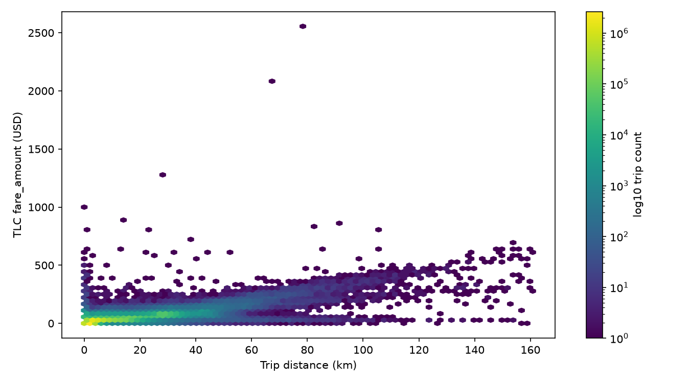
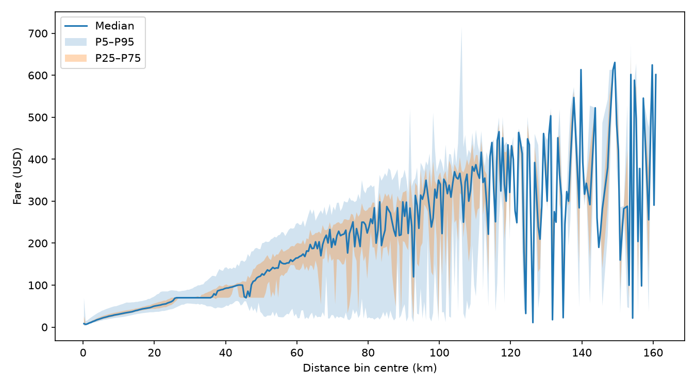
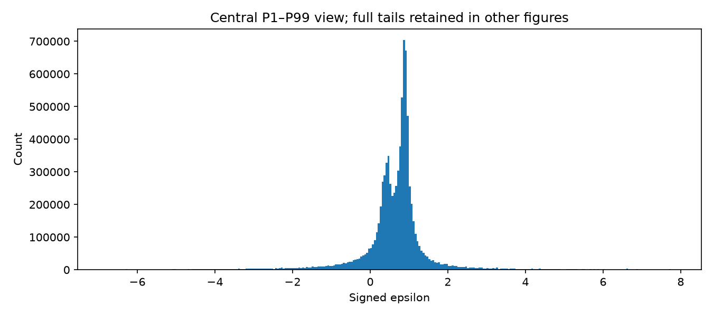
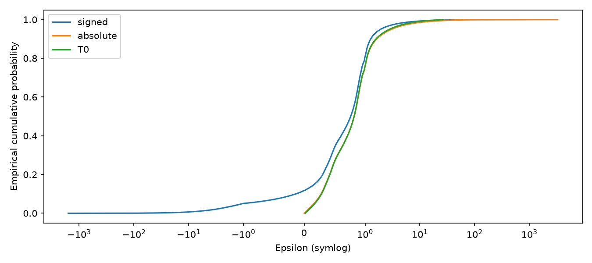
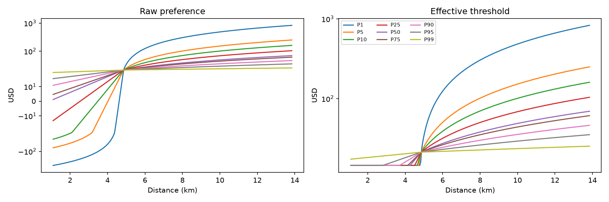
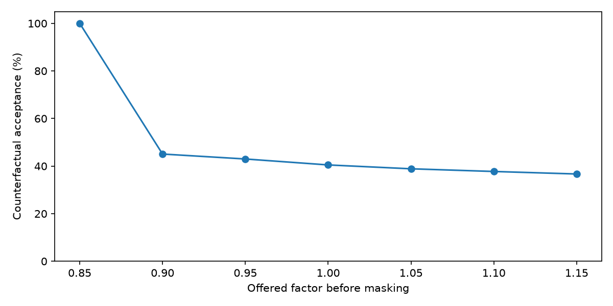
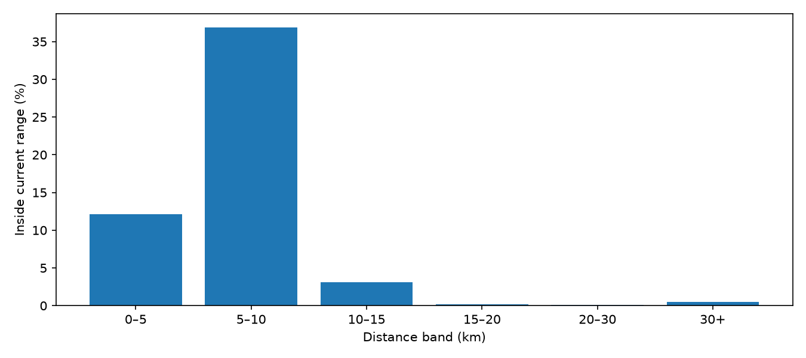
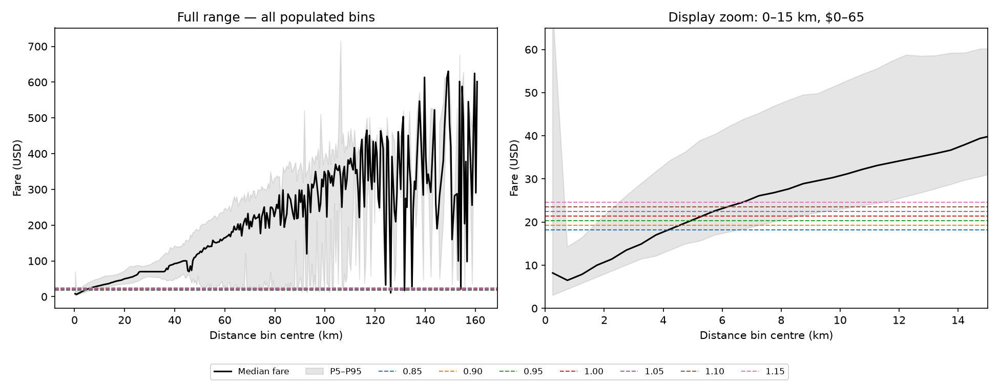

# Passenger-Sensitive Dynamic Pricing — Additional Empirical Analysis

## 1. Reason for Follow-up Analysis

The additional review requested evidence on observed fare–distance structure, a possible minimum-fare/flat-distance region, signed and positive sensitivity, same-distance acceptable-price variation, pre-mask passenger acceptance, action-space coverage and the existing references. This synthesis uses completed outputs and QA_RECONCILIATION.md as the final QA authority. It introduces no analysis, training or modelling change. The next step is an academic decision, not another DQN run.

## 2. Data and Temporal Scope

Fare and sensitivity analyses use Jan1–Mar15 only. The cleaned fare population contains **8,692,819** records. Fare is TLC fare_amount renamed fare, in USD; source trip_distance is miles, converted by 1.609344 before km summaries. Existing cleaning retains finite positive fares and 0 < trip_distance <= 100 miles. March16 00:00–02:00 is a saved development/counterfactual illustration only. Historical frozen reference provenance is retained, not recalculated.

No March17–31 analytical rows were selected or used. Because the date-filtered source reads may operate on mixed-date Parquet row groups, zero protected-date byte access cannot be established.

The minimum, signed-distribution and action-coverage findings describe completed-trip records or model outputs; they do not identify causal willingness to pay. Source: QA sections 1 and 18; original source path `data/processed/price_distance_sensitivity_record029/authoritative_epsilon_jan_mar_2026.parquet`.

## 3. NYC Fare and Distance Distribution

The reconciled minimum/maximum/median fare is **$0.01 / $2,555.20 / $15.60**; distance is **0.01609344 / 160.82174592 / 3.02556672 km**. $0.01 is the minimum recorded positive fare under the existing cleaning contract, not the NYC operational minimum. **RAW_MINIMUM_OPERATIONALLY_REPRESENTATIVE = NO**.

| Statistic | Fare (USD) | Distance (km) |
| --- | --- | --- |
| N | 8692819 | 8692819 |
| min | 0.01 | 0.01609344 |
| max | 2555.2 | 160.82174592 |
| mean | 21.352107453289896 | 5.54866796973441 |
| population_SD | 17.480452931686603 | 6.798634167545703 |
| median | 15.6 | 3.02556672 |
| P1 | 4.4 | 0.22530816000000004 |
| P5 | 5.8 | 0.804672 |
| P25 | 10.0 | 1.7380915200000002 |
| P75 | 26.66 | 6.1155072 |
| P95 | 58.19 | 20.00414592 |
| P99 | 78.6 | 31.382208000000002 |

Source: `fare_distance/population_statistics.csv`.

**EXTREME_VALUE_SENSITIVITY = MODERATE.** Above-P99 observations contribute approximately 27.60% of fare squared deviations and 25.79% of distance squared deviations. Interpret means and SDs alongside quantiles; no extremes were retrospectively removed. Positive-fare cleaning compliance does not certify every record as operationally representative.



Figure 1. Recorded fare–distance density; full cleaned Jan1–Mar15 population.



Figure 2. Fare quantiles in 0.5-km bins; sparse tail bins are not stable tariff estimates.

## 4. Minimum-Fare / Flat-Distance Investigation

There are 283 exact-$0.01 records. Counts at or below $0.50/$1/$2/$3/$5 are 310/345/1,012/20,963/110,999. Available fields cannot distinguish fare adjustments, anomalies or legitimate unusual records.

| Band | N | P90 km | P95 km | P99 km |
| --- | --- | --- | --- | --- |
| exact_minimum | 283 | 18.095464 | 21.846845 | 28.63023 |
| minimum_plus_0p50 | 310 | 17.960279 | 21.383354 | 28.355032 |
| minimum_plus_1p00 | 345 | 17.725315 | 21.005158 | 27.848089 |
| fare_P1 | 109,248 | 2.816352 | 13.019593 | 25.403978 |
| fare_P5 | 450,709 | 1.174821 | 1.319662 | 15.11174 |

Source: `fare_distance/minimum_fare_distance_analysis.csv`. Tables display rounded values; source CSVs retain precision.

Exact-minimum distance P90/P95/P99 is 18.10/21.85/28.63 km; the fare-P5 band gives 1.17/1.32/15.11 km. The latter is fare <= $5.80, not exactly 5% of records because of ties. Candidate cutoffs are highly definition-sensitive.

**EMPIRICAL_FLAT_FARE_REGION = NOT_SUPPORTED:** the analysed fare field and current cleaned data do not establish a stable empirical flat-distance cutoff. This does not mean NYC has no minimum-fare mechanism. No d_min or L_flat is adopted.

## 5. Signed Passenger Sensitivity Distribution

Signed VALID finite nonzero N is **8,685,488**. Negative epsilon is empirically present: **11.734355%**. The historical formula is a ratio of relative price deviation to relative distance deviation; negative values are not automatically errors or causal preference estimates.

| Statistic | Signed epsilon |
| --- | --- |
| N | 8685488 |
| mean | 0.640620734577789 |
| population_SD | 7.106334709447966 |
| sample_SD | 7.106335118540427 |
| median | 0.762119875337521 |
| min | -1574.64009775221 |
| max | 3282.8090993751007 |
| P1 | -6.804056630608886 |
| P5 | -1.019839532588369 |
| P10 | -0.13766782829336185 |
| P25 | 0.38035831345639487 |
| P75 | 0.9463451173290677 |
| P90 | 1.2691375200766368 |
| P95 | 1.9322193689227907 |
| P99 | 7.76871498390393 |
| positive_N | 7666302 |
| positive_pct | 88.26564494706572 |
| negative_N | 1019186 |
| negative_pct | 11.734355052934275 |
| zero_N | 0 |
| abs_lt_0.001_N | 814 |
| abs_lt_0.005_N | 4384 |
| abs_lt_0.01_N | 13257 |

Source: `sensitivity_distribution/epsilon_distribution_statistics.csv`. Sign shares are percentages; near-zero entries are counts. Zero count refers to the specified nonzero selected population.



Figure 3. High-resolution signed histogram: display-only P1–P99 window, 0.05 bins; full tails remain in statistical summaries.

## 6. Positive Sensitivity Magnitude and T0 Support

The operation order is date/VALID/finite/nonzero filtering, then abs(epsilon), then positive empirical quantiles. No signed historical support is applied first. Inclusive T0 bounds are **[0.017809913104763053, 27.324599740032788]**, retaining **8,598,805** observations.

| Distribution | N | Mean | SD | Median |
| --- | --- | --- | --- | --- |
| Signed | 8,685,488 | 0.640621 | 7.106335 | 0.76212 |
| Absolute before support | 8,685,488 | 1.414638 | 6.99351 | 0.820126 |
| Positive T0 | 8,598,805 | 1.095299 | 1.8173 | 0.820123 |

Source: `sensitivity_distribution/epsilon_distribution_statistics.csv`. Tables display rounded values; source CSVs retain precision.

**CURRENT_T0_SUPPORT_CONSISTENT_WITH_NEW_ANALYSIS = YES.** This means numerical reproduction and consistency with the completed analysis. It does not establish behavioural validity, a causal willingness-to-pay interpretation, optimal truncation or superiority over every alternative.

Sampling remains **TRUNCATED_EMPIRICAL_RESAMPLING**, with replacement and duplicate frequencies preserved; no extra epsilon floor or fitted parametric family is adopted. T0 has symmetric nominal tail probabilities, not symmetric numerical bounds.



Figure 4. Signed, pre-support absolute and supported T0 ECDFs; the T0 curve describes the supported distribution. Symlog horizontal axis.

## 7. Passenger Acceptable-Price Behaviour

The active formula is:

`P_raw_c = P_base + (P_base / epsilon_c) × ((L - L_base) / L_base)`

`P_accept_c = max(0.85 × P_base, P_raw_c)`

P_raw_c is raw equation output; P_accept_c is the effective threshold; P_offer is the chosen fare. With the same distance, different empirical epsilon quantiles produce different raw values, protected thresholds and feasible action sets. Below L_base the adjustment is negative; above it positive. At L_base it is zero.

| km | Quantile | Epsilon | Raw USD | Accept USD | Arms |
| --- | --- | --- | --- | --- | --- |
| 2 | P5 | 0.172571 | -51.413408 | 18.143989 | 1 |
| 2 | P50 | 0.820123 | 6.035807 | 18.143989 | 1 |
| 2 | P95 | 2.818563 | 16.891071 | 18.143989 | 1 |
| 10 | P5 | 0.172571 | 152.322882 | 152.322882 | 7 |
| 10 | P50 | 0.820123 | 48.906151 | 48.906151 | 7 |
| 10 | P95 | 2.818563 | 29.365138 | 29.365138 | 7 |

Source: `acceptable_price/same_distance_passenger_examples.csv`. Tables display rounded values; source CSVs retain precision.

These are saved formula illustrations using empirical epsilon quantiles, not observed same-distance passenger records. Historical supported-trip diagnostics additionally preserve negative raw outputs: 1,229,215 nonpositive and 4,080,228 positive-below-minimum values; protection applies to 5,309,443 records (61.746289%). This paired historical diagnostic is distinct from runtime resampling.



Figure 5. Same-distance price responses to empirical T0 epsilon quantiles; formula illustrations, not observed individual willingness to pay.

## 8. Counterfactual Passenger Acceptance by Pricing Action

The exact 2,838-request Episode25 March16 export is crossed with seven actions (19,866 rows). Each row applies P_offer=factor×P_base and acceptance iff P_offer<=P_accept_c.

| Factor | Accepted | Rejected | Acceptance % |
| --- | --- | --- | --- |
| 0.85 | 2,838 | 0 | 100 |
| 0.9 | 1,279 | 1,559 | 45.066949 |
| 0.95 | 1,220 | 1,618 | 42.98802 |
| 1 | 1,149 | 1,689 | 40.486258 |
| 1.05 | 1,103 | 1,735 | 38.865398 |
| 1.1 | 1,071 | 1,767 | 37.737844 |
| 1.15 | 1,041 | 1,797 | 36.680761 |

Source: `counterfactual_acceptance/march16_acceptance_curve.csv`. Tables display rounded values; source CSVs retain precision.

**0.85 = 100% is STRUCTURAL_BY_CONSTRUCTION**: P_accept_c=max(0.85×P_base,P_raw_c) guarantees 0.85×P_base<=P_accept_c for valid inputs. It is not independent evidence that all passengers willingly accept that offer.

The fall at 0.90 comes from 551 nonpositive-raw and 960 positive-below-minimum requests, plus 48 within-platform-range thresholds below the next arm: 1,559 rejections in total. Current runtime masks infeasible actions before selection, yielding zero observed passenger rejection. These counterfactuals show that offering higher actions before masking would produce substantial rejection under the current deterministic model. They do not predict which actions a retrained DQN would choose or the resulting fleet/revenue path.

Should acceptance remain a pre-selection feasibility constraint or become an explicit post-action environment outcome? This is open; neither answer is selected here.



Figure 6. Deterministic pre-mask acceptance on the 2,838 saved March16 requests; no dispatch simulation.

## 9. Current DQN Action-Space Coverage

Exactly **14.379972710808772%** of **8,692,819 cleaned Jan1–Mar15 fares** satisfy 0.85<=observed_fare/P_base<=1.15. Counts below/inside/above are 4,981,183 / 1,250,025 / 2,461,611. This is not a March16 or supported-epsilon-only denominator.

| Lower km | Upper km | N | Inside % |
| --- | --- | --- | --- |
| 0 | 5 | 6,030,518 | 12.121778 |
| 5 | 10 | 1,355,140 | 36.89272 |
| 10 | 15 | 555,976 | 3.129452 |
| 15 | 20 | 316,303 | 0.200125 |
| 20 | 30 | 311,622 | 0.124831 |
| 30 | inf | 123,260 | 0.527341 |

Source: `action_space_validation/action_range_coverage_by_distance.csv`. Tables display rounded values; source CSVs retain precision.

**FIXED_GLOBAL_ACTION_SPACE_EMPIRICAL_COVERAGE = WEAK** for representing broad observed fare variation, particularly at longer distances. The seven factors produce one fixed dollar interval around global P_base. This does not automatically invalidate a deliberately narrow adjustment experiment or establish a better alternative. No actions are redesigned.



Figure 7. Historical fare coverage by distance; Jan1–Mar15 cleaned population.



Figure 8. Current action prices over empirical fare quantiles; full-range panel and labelled display zoom.

## 10. Review of P_base and L_base

P_base remains **21.34586956773507 USD**, the previously frozen full-cleaned-Jan–Mar mean fare. Restricted Jan1–Mar15 mean is 21.352107453289896, median15.60 and P25/P75=10/26.66 USD. **P_BASE_EMPIRICAL_SUPPORT = MODERATE**: moderately defensible as a global reference, not validated as a universal fare level.

L_base remains **4.856998243316242 km**, converted from the historical price-conditioned mean3.01799878914405 miles for fares within ±$1 of P_base. Restricted mean distance is5.54866796973441, median3.02556672 and P25/P75=1.73809152/6.1155072 km. **L_BASE_EMPIRICAL_SUPPORT = MODERATE**; **L_base == L_flat = NOT_ESTABLISHED**. These are qualitative provenance/context assessments, not statistical validation gates.

| Half-width km | N | Mean USD | Median USD | P25 USD | P75 USD |
| --- | --- | --- | --- | --- | --- |
| 0.25 | 280,174 | 22.427749 | 20.5 | 17.7 | 24.7 |
| 0.5 | 563,369 | 22.376043 | 20.44 | 17.7 | 24.7 |
| 1 | 1,186,243 | 21.903147 | 19.8 | 17 | 24.11 |

Source: `reference_value_review/fare_near_Lbase.csv`. Tables display rounded values; source CSVs retain precision.

Windows around L_base are descriptive checks, not new reference definitions. Neither reference is changed.

## 11. Findings That Support Current V1

| Finding | Evidence status |
| --- | --- |
| Signed epsilon explicitly investigated | SUPPORTED |
| Positive T0 support numerically reproducible | SUPPORTED |
| Empirical resampling | SUPPORTED AS IMPLEMENTED |
| Epsilon changes acceptable prices at fixed distance | SUPPORTED WITHIN CURRENT MODEL |
| Request-level DQN implementation | TECHNICALLY VALID — prior canonical evidence |
| Request-step gamma correction | UNCHANGED / OUTSIDE THIS FOLLOW-UP ISSUE |
| Technical invariants | PASS — prior staged/replay evidence |

Numerical reconciliation is not proof of behavioural validity or policy optimality. This synthesis preserves the prior canonical technical results without rerunning them.

## 12. Findings That Raise New Questions

The recorded minimum does not identify an operational floor; low-fare distance quantiles do not produce a stable L_flat; the global action interval has weak broad fare-distance coverage; and zero selected-offer rejection follows from the mask. These findings motivate interpretation and design decisions, not automatic implementation changes.

| Question | Evidence | Decision required |
| --- | --- | --- |
| Operational minimum fare | NOT ESTABLISHED | YES |
| L_flat | NOT ESTABLISHED | YES |
| Platform minimum 0.85×P_base | PROJECT MODEL CHOICE | YES |
| Positive absolute epsilon | Numerically consistent; behavioural meaning open | YES |
| T0 truncation | Reproducible, not proven optimal | YES |
| Global action range | WEAK broad empirical coverage | YES |
| Distance-relative actions | OPEN | YES |
| Pre-action mask / post-action rejection | OPEN | YES |
| Further DQN training | PAUSED | YES |

## 13. Questions Requiring Academic Decision

The ten decision questions concluding this document govern the next review. `DECISION_MATRIX.csv` separates twelve implementation topics—including sign, magnitude, support and sampling—from those ten meeting questions. Keep-current and alternative columns describe options, not recommendations. Further implementation changes and training remain blocked pending the relevant decision.

## 14. Current Modelling Status

The follow-up supports numerical consistency of calibration and demonstrates epsilon-dependent feasible prices within the current model. It does not establish a stable minimum-fare distance cutoff. The global action range represents a small portion of observed fare variation; the zero-rejection runtime result reflects masking, not acceptance of every candidate price. The next step is academic judgement, not additional DQN training.

QA status is **WITH_QUALIFICATIONS**. This final package labels percentage metrics correctly in KEY_RESULTS.csv; original master metadata is preserved. Existing figures are embedded unchanged, including the labelled action-overlay zoom; their exact files and hashes are recorded in FIGURE_INDEX.md. No unsupported optimality claim is made.

## 15. Proposed Next Step After Academic Review

Record the academic decisions first; then specify and validate only the authorized changes. Training requires a separate explicit authorization. No preferred replacement methodology is inferred from these descriptive outputs.

1. Does the dataset provide enough evidence to introduce an empirical minimum-fare mechanism?
2. Should an L_flat rule be introduced when no stable cutoff was established?
3. Is the current positive absolute sensitivity interpretation acceptable after seeing the signed distribution?
4. Is empirical P0.5–P99.5 truncation/resampling acceptable?
5. Should the platform minimum continue as 0.85*P_base, or should another empirically grounded lower constraint be defined?
6. Given weak coverage of the global action set, should pricing actions remain global factors or become distance-relative / fare-reference-relative?
7. Should passenger acceptance remain a hard pre-selection mask?
8. Or should DQN select a price first and passenger acceptance/rejection become an explicit environment outcome?
9. If rejection becomes explicit, what should the reward/penalty be?
10. Should further DQN training remain paused until these choices are resolved?

```text
FOLLOWUP_ANALYSIS_NUMERICALLY_RECONCILED = YES
FOLLOWUP_ANALYSIS_ACADEMICALLY_PRESENTABLE = WITH_QUALIFICATIONS
EMPIRICAL_FLAT_FARE_REGION = NOT_SUPPORTED
RAW_MINIMUM_OPERATIONALLY_REPRESENTATIVE = NO
CURRENT_T0_SUPPORT_CONSISTENT_WITH_NEW_ANALYSIS = YES
FIXED_GLOBAL_ACTION_SPACE_EMPIRICAL_COVERAGE = WEAK
P_BASE_EMPIRICAL_SUPPORT = MODERATE
L_BASE_EMPIRICAL_SUPPORT = MODERATE
ACTION_085_ACCEPTANCE = STRUCTURAL_BY_CONSTRUCTION
NO_METHODOLOGY_CHANGE_YET = YES
FURTHER_DQN_TRAINING_PAUSED = YES
NO_PROTECTED_DATE_ANALYTICAL_ROWS_USED = YES
```
